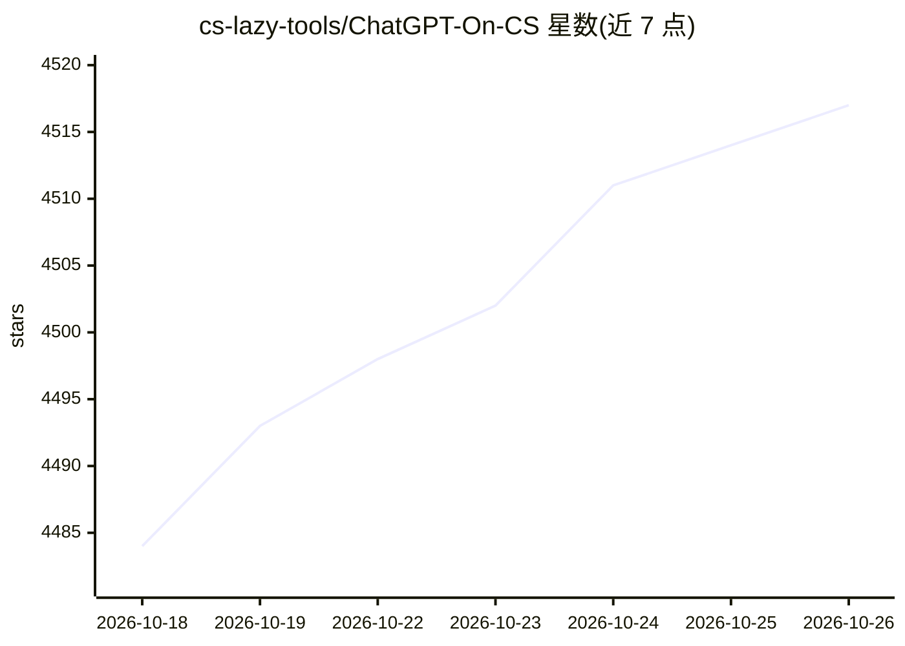

# cs-lazy-tools/ChatGPT-On-CS

⭐ 4,517 · TypeScript · AGPL-3.0 · 推送 2026-10-10 · [GitHub](https://github.com/cs-lazy-tools/ChatGPT-On-CS) · [官网](https://jinxiaoai.com/) · 组织维护 · 中文 README

**面向电商的多平台 AI 智能客服 SaaS，自动回复与售后处理**

金销数据云智能客服是基于 LLM 的电商客服解决方案，统一对接微信、千牛、抖音、抖店、拼多多、小红书、京东、微博等平台，自动生成客户咨询回复，支持预设模板、知识库定制、插件扩展与客服数据分析，可接入 GPT/通义千问/文心一言/DeepSeek 等模型并处理文本、语音、图片。README 同时包含开源版本说明与商业 SaaS 版本入口（jinxiaoai.com），商业使用需另行授权，本地大模型支持仍在开发中。

## 筛选速览

| 维度 | 判定 | 备注 |
|---|---|---|
| AI 角色 | `ai-native` | 本体是模型或模型工具 |
| 许可风险 | `dual` | AGPL-3.0 |
| 部署形态 | `None` |  |
| 模型依赖 | locked-api |  |
| 硬件要求 | — | 无带数字的原话,不猜 |
| 安装摩擦 | `low` | 无编译、无系统依赖或容器化 |
| 成熟度 | — | 结构信号不足 |

## 能力要点

- 统一接入微信、千牛、抖店、拼多多、小红书等多平台客服会话
- 支持 GPT3.5/GPT4.0/通义千问/文心一言/DeepSeek 等多种大模型
- 自有知识库上传定制与插件生态扩展
- 场景训练台可模拟进线测试，回答标注依据

## 适用场景

- 电商商家在多平台店铺用 AI 统一接待客户咨询
- 上传商品资料构建知识库，自动答复商品与售后问题
- 通过场景 Agent 与行为策略按店铺定制 AI 接待行为

## 场景标签

`聊天机器人` · 领域:对话与助手

## 证据(README 行号)

> L5: 金销数据云智能客服是基于大语言模型（LLM）打造的专业电商客服 SaaS 解决方案，专为电商行业量身定制。无缝对接主流电商平台，支持微信、千牛、抖音、飞鸽、拼多多、小红书、京东、淘宝、京麦等多平台统一管理，让您的客服工作更智能、更高
> L29: 本项目支持 GPT3.5/GPT4.0/通义千问/文心一言/DeepSeek 等主流大模型，能处理文本、语音和图片，通过插件访问操作系统和互联网等外部资源，支持基于自有知识库定制企业 AI 应用。
> L42: - ✅ **智能问答**：基于 AI 大模型，智能理解客户咨询，自动生成专业回复

## 星数曲线

2026-10-18 4,484 → 2026-10-26 4,517（+33）

---
*卡片 v1 · prompt 1.4 · 生成 2026-10-20 · 置信度 high · 依据 README sha `950ce71bf4f4` · [字段定义](../../DATASET.md)*
