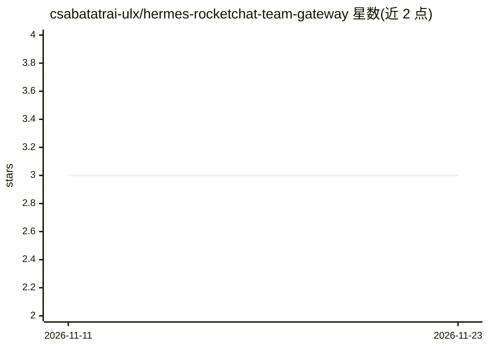

# csabatatrai-ulx/hermes-rocketchat-team-gateway

⭐ 3 · Python · Apache-2.0 · 推送 2026-11-11 · [GitHub](https://github.com/csabatatrai-ulx/hermes-rocketchat-team-gateway) · [官网](https://csabatatrai-ulx.github.io/hermes-rocketchat-team-gateway/) · 组织维护

**让 Hermes Agent 在 Rocket.Chat 团队房间中安全协作的适配器**

面向自托管 Rocket.Chat 的 Hermes Agent 平台适配器：一个机器人服务整个团队，每人拥有独立会话与房间上下文，聊天中默认拒绝 Hermes 命令，危险操作需通过审批按钮由提问者本人点击执行。插件只承载消息传输，代理保留 Hermes 全部工具；支持 Rocket.Chat 8.7–9.x，可配置为共享房间机器人或单人私人助理，自带 780 项单元测试与端到端验证脚本。

## 筛选速览

| 维度 | 判定 | 备注 |
|---|---|---|
| AI 角色 | `ai-ecosystem` | LLM/agent 周边工具 |
| 许可风险 | `permissive` | Apache-2.0 |
| 部署形态 | `self-host` | docker 或自建部署 |
| 模型依赖 | — | README 未给出锁定关系 |
| 硬件要求 | — | 无带数字的原话,不猜 |
| 安装摩擦 | `low` | 无编译、无系统依赖或容器化 |
| 成熟度 | — | 结构信号不足 |

## 能力要点

- 共享房间中每人独立会话，回答引用提问并 @ 提问者
- 命令默认拒绝，危险命令经审批按钮由提问者本人执行
- 重启/断线后的去重、未处理消息重放机制
- 仅依赖 aiohttp，与 Hermes 官方 Slack/Mattermost 适配器同等作用域

## 适用场景

- 团队共享房间里通过 @hermes 提问和执行运维任务
- ChatOps 场景中危险命令等待人工审批后再执行
- 自托管环境下将 AI 代理接入企业内部聊天
- 按配置将同一插件用作单人私人助理

## 场景标签

`聊天机器人` `AI 助手` · 领域:对话与助手

## 证据(README 行号)

> L12: **Bringing Hermes Agent into the enterprise team chat.** Rocket.Chat is the open source, self-hosted chat that orga
> L147: No tools of its own does not mean a bot without tools. In Rocket.Chat the agent uses every tool Hermes gives it: t
> L7: Hermes Agent 0.22.3+

## 星数曲线

2026-11-11 3 → 2026-11-23 3（+0）

---
*卡片 v1 · prompt 1.4 · 生成 2026-11-22 · 置信度 high · 依据 README sha `9587396b9683` · [字段定义](../../DATASET.md)*
