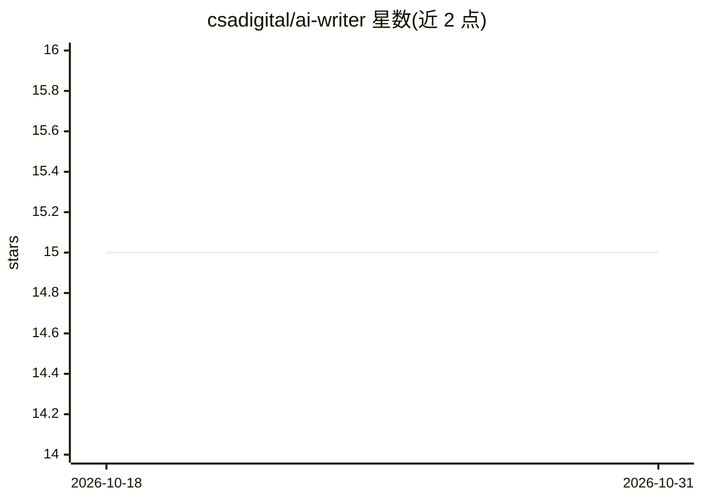

# csadigital/ai-writer

⭐ 15 · JavaScript · ISC · 推送 2026-10-11 · [GitHub](https://github.com/csadigital/ai-writer) · 个人维护

**面向电商卖家：从商品图片生成六语种产品文案的 Web 应用**

基于 Node.js/Express 的自托管 Web 应用：用户提供 1-8 张商品图片（或经 Puppeteer 从商品页抓取链接），调用 OpenAI 视觉模型生成英文、土耳其语、西班牙语、德语、法语、中文的产品描述草稿，并支持浏览器内编辑与一键翻译。内置账户系统（bcrypt、MySQL 会话）与积分机制（新账户 10 积分，生成/翻译各消耗 1 积分，失败退款），无支付集成。附带实验性 YouTube 视频抽帧起草功能（依赖 FFmpeg）。安装提供 npm run setup 自动化脚本，可选 Docker 起 MySQL。

## 筛选速览

| 维度 | 判定 | 备注 |
|---|---|---|
| AI 角色 | `ai-native` | 本体是模型或模型工具 |
| 许可风险 | `permissive` | ISC |
| 部署形态 | `self-host` | docker 或自建部署 |
| 模型依赖 | — | README 未给出锁定关系 |
| 硬件要求 | — | 无带数字的原话,不猜 |
| 安装摩擦 | `low` | 无编译、无系统依赖或容器化 |
| 成熟度 | — | 结构信号不足 |

## 能力要点

- 从 1-8 张商品图生成六语种产品描述草稿
- Puppeteer 抓取公开商品页的图片链接
- 账户、积分与失败退款机制（无支付集成）
- npm run setup 自动安装，可选 Docker MySQL 或已有 MySQL 8+ 服务器

## 适用场景

- 电商卖家从商品照片快速生成多语言产品描述
- 在小团队内自托管一个带账户与积分控制的文案工作台
- 从 YouTube 短视频抽帧起草视频相关文案（实验性）

## 场景标签

`AI 写作` · 领域:内容生成

## 证据(README 行号)

> L8:  Turn product photos into clear, multilingual ecommerce copy. Paste images. Choose a language. Make the draft your o
> L13: - **Write from images:** generate descriptions from one to eight public HTTPS product photos.
> L30: - An OpenAI API key with access to a vision-capable Chat Completions model

## 星数曲线

2026-10-18 15 → 2026-10-31 15（+0）

---
*卡片 v1 · prompt 1.4 · 生成 2026-10-30 · 置信度 high · 依据 README sha `40838bc55c34` · [字段定义](../../DATASET.md)*
