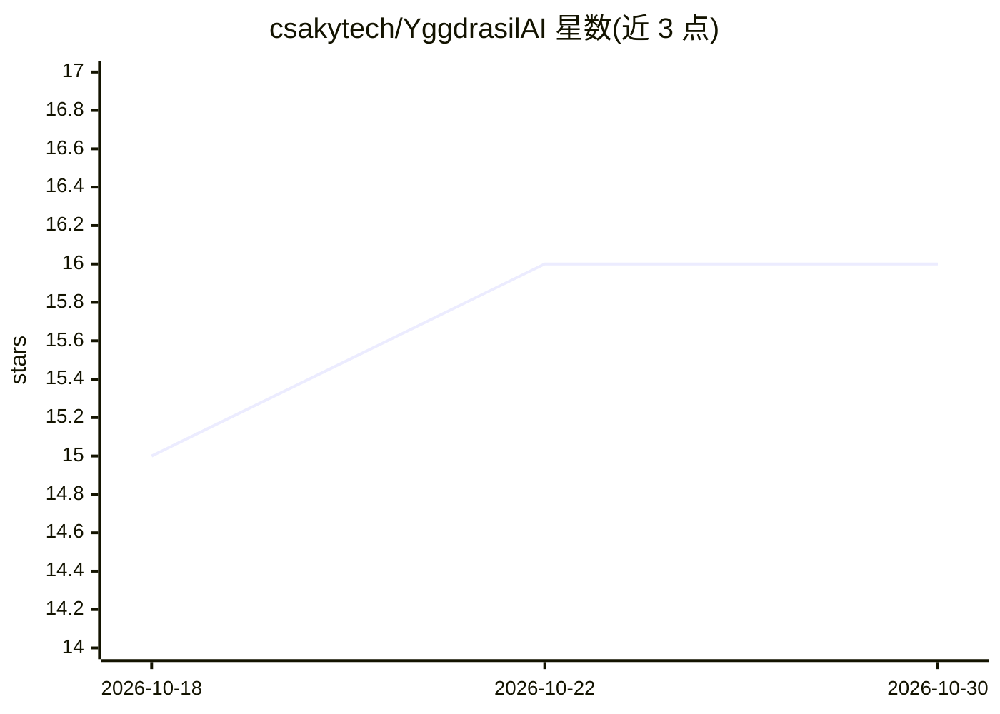

# csakytech/YggdrasilAI

⭐ 16 · Python · Apache-2.0 · 推送 2026-08-24 · [GitHub](https://github.com/csakytech/YggdrasilAI) · [官网](https://www.yggdrasilai.org) · 个人维护

**语音驱动的 AI-first Linux 发行版，供无法用键鼠者独立操作电脑**

基于 Debian 13 的本地优先操作系统发行版：用户以自然语言说出目标，端侧 AI（faster-whisper STT + Ollama 本地 LLM + Piper TTS）制定计划，由一组受权限管控的 agent 执行文件操作、应用启动、实时问答、提醒、终端命令等任务；危险操作需语音/键入确认。面向无法使用键盘鼠标的用户（重度关节炎、手部损伤等）。通过下载 ISO 写入 USB 启动安装；社区市场可语音安装 agent，未验证 agent 在 bubblewrap 沙箱内运行。部分功能（CLI 合成）标注为原型，云端 LLM 选项未发布。

## 筛选速览

| 维度 | 判定 | 备注 |
|---|---|---|
| AI 角色 | `ai-native` | 本体是模型或模型工具 |
| 许可风险 | `permissive` | Apache-2.0 |
| 部署形态 | `None` |  |
| 模型依赖 | local-ok | 支持本地模型 |
| 硬件要求 | — | 无带数字的原话,不猜 |
| 安装摩擦 | `low` | 无编译、无系统依赖或容器化 |
| 成熟度 | — | 结构信号不足 |

## 能力要点

- 全离线语音管线：faster-whisper + Ollama + Piper，断网仍可用
- 受权限层管控的多 agent 架构，危险操作需确认并硬拦截灾难性命令
- 社区市场支持语音安装 agent，未验证 agent 在 bubblewrap 沙箱运行
- 提供 agent-template 与 yggdrasil.sdk 供开发者编写新 agent

## 适用场景

- 因关节炎或手部损伤无法用键鼠的人独立操作电脑
- 不想把语音数据送上云、要求全本地运行的语音助手环境
- 开发者按 manifest.toml + SDK 编写并发布自己的 agent 技能

## 场景标签

`多智能体` `语音 Agent` `GUI 自动化` · 领域:Agent 开发

## 证据(README 行号)

> L5: **ThorOS** is an AI-first, **local-first, voice-driven operating system** — a Debian 13 derivative you
> L24: And it's voice-first for a reason: **so people who can't use a keyboard or mouse — severe arthritis,
> L81: - **The stack** — faster-whisper (STT), Ollama (local LLM), Piper (TTS), a GTK desktop, and bubblewrap

## 星数曲线

2026-10-18 15 → 2026-10-30 16（+1）

---
*卡片 v1 · prompt 1.4 · 生成 2026-10-30 · 置信度 high · 依据 README sha `02dcddbefd3a` · [字段定义](../../DATASET.md)*
