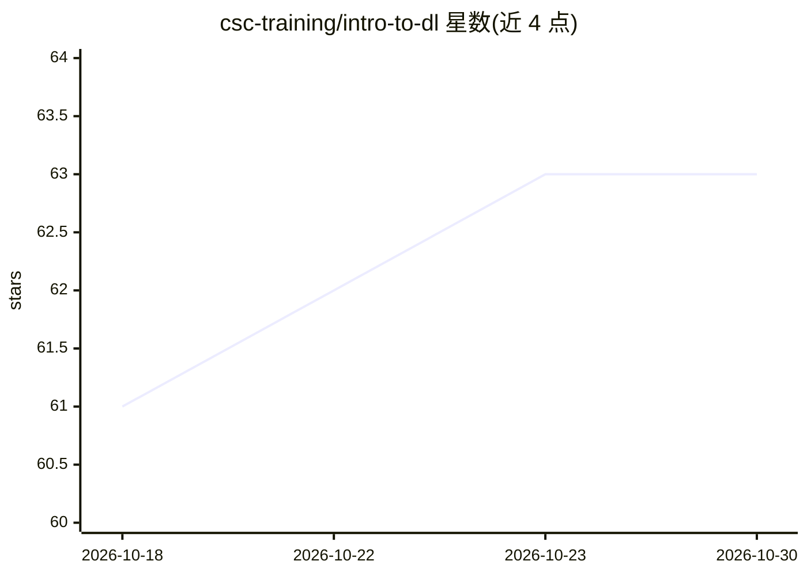

# csc-training/intro-to-dl

⭐ 63 · Python · MIT · 推送 2026-10-22 · [GitHub](https://github.com/csc-training/intro-to-dl) · 组织维护

**深度学习课程的练习材料仓库（CSC 课程）**

芬兰 CSC（科学计算中心）'Practical deep learning' 课程的练习材料仓库，README 仅列出按天组织的练习内容（day 1、day 2），主题标签涉及 deep-learning、keras、pytorch、tensorflow、machine-learning。仓库内容为教学练习，未描述安装运行流程或成品工具。可见 README 仅 6 行，信息有限。

## 筛选速览

| 维度 | 判定 | 备注 |
|---|---|---|
| AI 角色 | `ai-knowledge` | 知识聚合/清单类 |
| 许可风险 | `permissive` | MIT |
| 部署形态 | `None` |  |
| 模型依赖 | — | README 未给出锁定关系 |
| 硬件要求 | — | 无带数字的原话,不猜 |
| 安装摩擦 | `low` | 无编译、无系统依赖或容器化 |
| 成熟度 | — | 结构信号不足 |

## 能力要点

- CSC 'Practical deep learning' 课程的练习材料
- 按天组织的练习（day 1 / day 2）
- 主题标签覆盖 Keras、PyTorch、TensorFlow

## 适用场景

- 跟随 CSC 深度学习课程做练习
- 参考课程配套的上手材料

## 场景标签

`教程课程` · 领域:学习与行业

## 证据(README 行号)

> L3: This repository contains the exercise materials for the CSC course Practical deep learning.

## 星数曲线

2026-10-18 61 → 2026-10-30 63（+2）

---
*卡片 v1 · prompt 1.4 · 生成 2026-10-24 · 置信度 mid · 依据 README sha `1d40d6e5fd34` · [字段定义](../../DATASET.md)*
