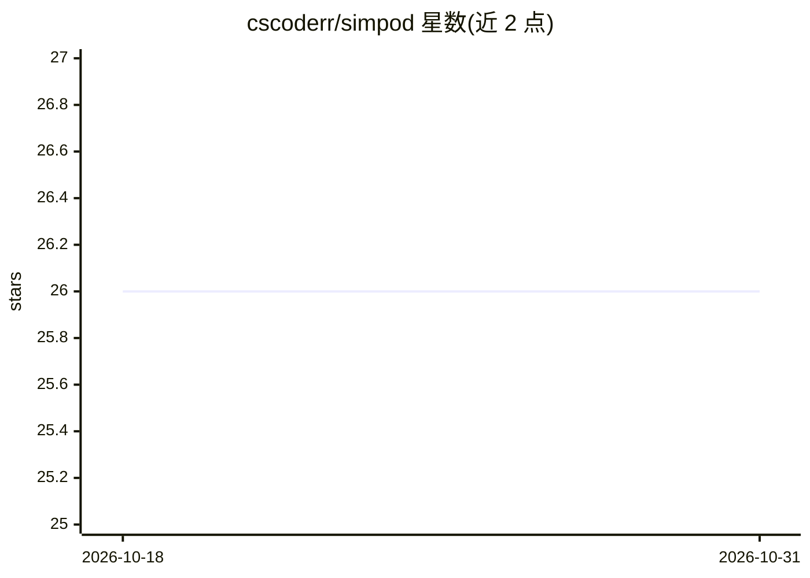

# cscoderr/simpod

⭐ 26 · Dart · Apache-2.0 · 推送 2026-07-08 · [GitHub](https://github.com/cscoderr/simpod) · 个人维护

**从浏览器/终端/AI agent 远程串流并控制 iOS 模拟器**

Simpod 通过原生 Swift helper 捕获 iOS 模拟器画面（H.264 60FPS、MJPEG 回退）并注入触摸/键盘事件，经 HTTP/WebSocket 提供服务，配 Flutter Web 仪表盘与 Dart CLI。支持完整模拟器操作（点击、滑动、捏合、输入、硬件按键、旋转）、无障碍树检查、GPS 模拟、深链接、深浅色切换与日志查看，无需 Xcode 插件或 App 插桩。内置 Agent Skill 教 AI 编程助手（Claude Code、Cursor、Codex）通过 CLI 操作模拟器。要求 macOS 14+ 与 Xcode 命令行工具，经 dart pub global activate 安装。

## 筛选速览

| 维度 | 判定 | 备注 |
|---|---|---|
| AI 角色 | `ai-ecosystem` | LLM/agent 周边工具 |
| 许可风险 | `permissive` | Apache-2.0 |
| 部署形态 | `None` |  |
| 模型依赖 | — | README 未给出锁定关系 |
| 硬件要求 | — | 无带数字的原话,不猜 |
| 安装摩擦 | `low` | 无编译、无系统依赖或容器化 |
| 成熟度 | — | 结构信号不足 |

## 能力要点

- H.264 60FPS 低延迟串流，MJPEG 自动回退
- 无障碍树实时检查与按标签查找元素
- 内置面向 AI 编程助手的 Agent Skill
- 无需 Xcode 插件与 App 插桩，适配任意已启动模拟器

## 适用场景

- 在浏览器中远程查看和操控 iOS 模拟器
- 让 Claude Code/Cursor 等 AI agent 直接操作模拟器做自动化测试
- 通过 CLI 调试模拟器并读取无障碍树定位 UI 元素

## 场景标签

 · 领域:移动开发工具

## 证据(README 行号)

> L5: Simpod lets you remotely control an iOS Simulator from your browser, IDE, or AI agent such as **Claude Code**, **Cur
> L120: Simpod includes an **Agent Skill** that teaches AI coding agents how to operate the simulator through the CLI.

## 星数曲线

2026-10-18 26 → 2026-10-31 26（+0）

---
*卡片 v1 · prompt 1.4 · 生成 2026-10-26 · 置信度 high · 依据 README sha `880bbe28b812` · [字段定义](../../DATASET.md)*
