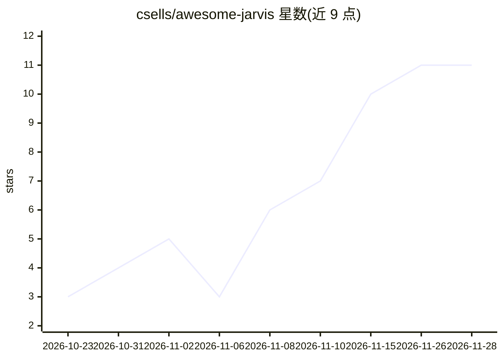

# csells/awesome-jarvis

⭐ 11 · Python · CC0-1.0 · 推送 2026-11-20 · [GitHub](https://github.com/csells/awesome-jarvis) · [官网](https://awesome-jarvis.com) · 个人维护

**构建语音优先个人 AI 助理（J.A.R.V.I.S.）的开源项目策展清单**

以四项标准（语音、免手操作、可视化呈现、对其他 agent 的监督）筛选并打分的 awesome 清单：收录十余个完整语音助理（开源与商业分列）、agent 调度与监督工具、以及语音/唤醒词等分层构建组件。每条目经两次独立评审对照代码或厂商文档核实，并在实验室实测部分项目；评分卡标注各项目的批准机制默认状态与注意事项，另提供 build-jarvis 技能作为构建指引。

## 筛选速览

| 维度 | 判定 | 备注 |
|---|---|---|
| AI 角色 | `ai-knowledge` | 知识聚合/清单类 |
| 许可风险 | `viral` | CC0-1.0 |
| 部署形态 | `library` | 以包/库形式分发 |
| 模型依赖 | — | README 未给出锁定关系 |
| 硬件要求 | — | 无带数字的原话,不猜 |
| 安装摩擦 | `medium` | 含编译或系统依赖之一 |
| 成熟度 | — | 结构信号不足 |

## 能力要点

- 按语音/免手/可视化/监督四项标准的评分卡与实测结果
- 开源与商业助理分节收录，标注各项目批准机制默认状态
- 按层级组织构建组件：调度监督、语音监督、agent 状态呈现
- 提供 build-jarvis 技能化构建指南

## 适用场景

- 挑选或对比可自托管的语音个人助理项目
- 自己搭建语音优先的 agent 调度与监督系统
- 了解各助理项目在批准与权限控制上的实测表现

## 场景标签

`精选清单` · 领域:学习与行业

## 证据(README 行号)

> L1: # Awesome Jarvis Awesome
> L14: I didn't take anyone's marketing at face value. Two independent reviews checked every agent in the scorecard agains
> L26: ● means shipped and working, ◐ means partial, limited or experimental, and ○ means absent. Two independent reviews 

## 星数曲线

2026-10-23 3 → 2026-11-28 11（+8）

---
*卡片 v1 · prompt 1.4 · 生成 2026-11-19 · 置信度 mid · 依据 README sha `c810ecca3f62` · [字段定义](../../DATASET.md)*
