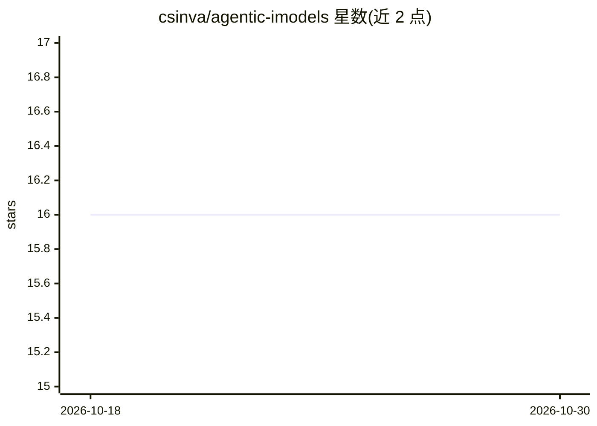

# csinva/agentic-imodels

⭐ 16 · Python · MIT · 推送 2026-10-05 · [GitHub](https://github.com/csinva/agentic-imodels) · [官网](https://arxiv.org/abs/2605.03808) · 个人维护

**面向 AI agent 的可解释回归模型库，由 coding agent 自动研究演化**

包含 10 个 scikit-learn 兼容回归器的库，其字符串表示被显式优化为可被另一个 LLM 读取，即'agent 可解释'。通过 coding agent（Claude Code、OpenAI Codex）在固定评测 harness 上循环迭代单文件模型代码，同时优化 RMSE 与 LLM 评分的可解释性测试通过率。仓库还包含针对 GOSDT 最优稀疏决策树与 RiskSLIM 稀疏风险评分的平行演化循环，以及泛化实验与端到端实验目录；随附 NeurIPS 2026 论文源码。需 Python 3.10+ 与 uv，从源码 clone 安装。

## 筛选速览

| 维度 | 判定 | 备注 |
|---|---|---|
| AI 角色 | `ai-native` | 本体是模型或模型工具 |
| 许可风险 | `permissive` | MIT |
| 部署形态 | `None` |  |
| 模型依赖 | — | README 未给出锁定关系 |
| 硬件要求 | — | 无带数字的原话,不猜 |
| 安装摩擦 | `low` | 无编译、无系统依赖或容器化 |
| 成熟度 | — | 结构信号不足 |

## 能力要点

- 10 个 Pareto 前沿的 scikit-learn 兼容回归器，兼容 Pipeline/GridSearchCV
- coding agent 在固定 harness 上循环迭代模型代码（autoresearch）
- 提供 Claude 与 Codex 两套 agent 循环及最优决策树/风险评分的平行循环
- evolved 模型接入 Claude Code/Codex/Copilot CLI 后 BLADE 基准提升 8%–47%

## 适用场景

- 在自己的数据科学项目中使用 agent 可解释的回归模型
- 将技能文件指针加入 CLAUDE.md/AGENTS.md 供 coding agent 调用
- 复现或自行运行 agent 演化循环做模型自动研究

## 场景标签

`编码 Agent` · 领域:编码与开发

## 证据(README 行号)

> L13: We built a library of 10 `scikit-learn`-compatible regressors whose string representations are explicitly optimized
> L72: Curated highlights from `agentic-imodels`. **Rank** is mean global RMSE rank across 65 dev datasets (lower is bette

## 星数曲线

2026-10-18 16 → 2026-10-30 16（+0）

---
*卡片 v1 · prompt 1.4 · 生成 2026-10-30 · 置信度 high · 依据 README sha `b3be4f1e2a26` · [字段定义](../../DATASET.md)*
