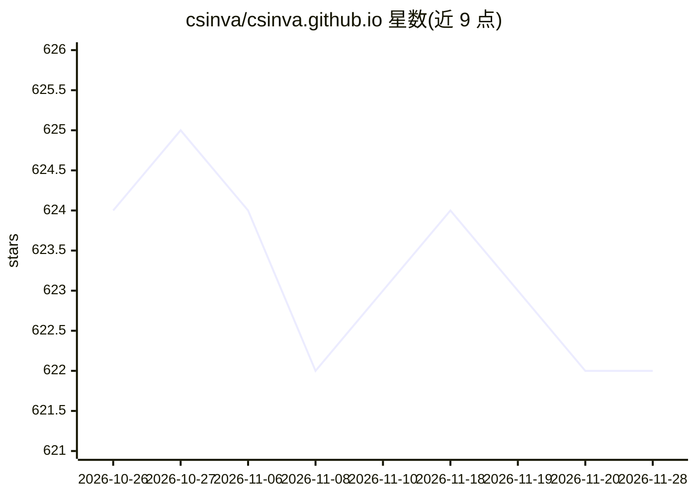

# csinva/csinva.github.io

⭐ 622 · HTML · MIT · 推送 2026-11-25 · [GitHub](https://github.com/csinva/csinva.github.io) · [官网](https://csinva.io) · 个人维护

**ML 研究者的课程讲义、论文笔记与科研综述个人站**

微软研究院研究员 Chandan（UC Berkeley 博士）维护的个人知识分享仓库，托管于 GitHub Pages：包含机器学习/AI 课程幻灯片（markdown + reveal-md 编写，可编辑导出）、可解释性/因果推断/迁移学习等方向的论文综述与摘要、跨计算机科学/统计/神经科学的课程笔记与 cheat sheet，以及博客文章。站点以 Jekyll 构建，内容开放使用。

## 筛选速览

| 维度 | 判定 | 备注 |
|---|---|---|
| AI 角色 | `ai-knowledge` | 知识聚合/清单类 |
| 许可风险 | `permissive` | MIT |
| 部署形态 | `None` |  |
| 模型依赖 | — | README 未给出锁定关系 |
| 硬件要求 | — | 无带数字的原话,不猜 |
| 安装摩擦 | `low` | 无编译、无系统依赖或容器化 |
| 成熟度 | — | 结构信号不足 |

## 能力要点

- Berkeley CS189 机器学习与 CS188 AI 课程幻灯片源码（markdown/reveal-md）
- 覆盖可解释性、因果推断、不确定性、DL 理论等方向的论文综述
- 计算机科学、统计、神经科学多领域课程笔记与 cheat sheet
- Jekyll + GitHub Pages 构建的静态站点

## 适用场景

- 学习机器学习与 AI 课程时参考讲义
- 查找可解释性等研究方向的论文综述入门材料
- 复习计算神经科学、线性代数等课程笔记

## 场景标签

`教程课程` · 领域:学习与行业

## 证据(README 行号)

> L13: ## Slides
> L24:  The research_ovws folder contains overviews and summaries of recent papers in different research areas
> L37:  The _notes folder contains markdown notes and cheat-sheets for many different courses and areas between computer s

## 星数曲线

2026-10-26 624 → 2026-11-28 622（-2）

---
*卡片 v1 · prompt 1.4 · 生成 2026-11-25 · 置信度 high · 依据 README sha `b9103490748d` · [字段定义](../../DATASET.md)*
