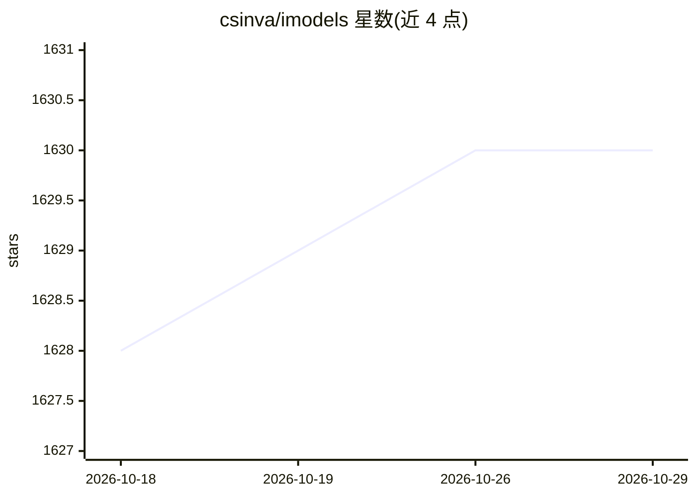

# csinva/imodels

⭐ 1,630 · Jupyter Notebook · MIT · 推送 2026-10-24 · [GitHub](https://github.com/csinva/imodels) · [官网](https://csinva.io/imodels) · 组织维护

**可解释机器学习 Python 库：20+ 种透明预测模型，兼容 sklearn**

提供规则集、规则列表、规则树与代数模型等 20 多种可解释模型的统一 scikit-learn 接口，覆盖二分类、多分类与回归任务，含蒸馏、层级收缩、AutoML 选择等包装器。所有模型遵循 sklearn estimator API，可在 pipeline 与网格搜索中使用；规则型模型通过 get_rules() 以 DataFrame 输出所学规则，树模型可用 dtreeviz 可视化。面向数据科学与科研用户，pip 安装。

## 筛选速览

| 维度 | 判定 | 备注 |
|---|---|---|
| AI 角色 | `ai-native` | 本体是模型或模型工具 |
| 许可风险 | `permissive` | MIT |
| 部署形态 | `library` | 以包/库形式分发 |
| 模型依赖 | — | README 未给出锁定关系 |
| 硬件要求 | — | 无带数字的原话,不猜 |
| 安装摩擦 | `low` | 无编译、无系统依赖或容器化 |
| 成熟度 | — | 结构信号不足 |

## 能力要点

- 20+ 种可解释模型（RuleFit、FIGS、Bayesian rule list、层级收缩等）统一 sklearn 接口
- get_rules() 以 DataFrame 输出规则，支持 feature_importances_ 与 apply(X)
- 蒸馏、AutoML 选择、后验正则化等包装器
- 提供演示 notebook 与临床决策规则示例

## 适用场景

- 用规则列表/规则树替代黑箱模型做可解释预测
- 从数据中提炼临床决策规则或风险评分
- 训练后检视、可视化和解释模型所学规则

## 场景标签

 · 领域:机器学习/数据科学

## 证据(README 行号)

> L13: Modern machine-learning models are increasingly complex, often making them difficult to interpret. This package pro
> L94: Different models support different machine-learning tasks. Current support for different models is given below (eac

## 星数曲线

2026-10-18 1,628 → 2026-10-29 1,630（+2）

---
*卡片 v1 · prompt 1.4 · 生成 2026-10-21 · 置信度 high · 依据 README sha `e565031389a7` · [字段定义](../../DATASET.md)*
