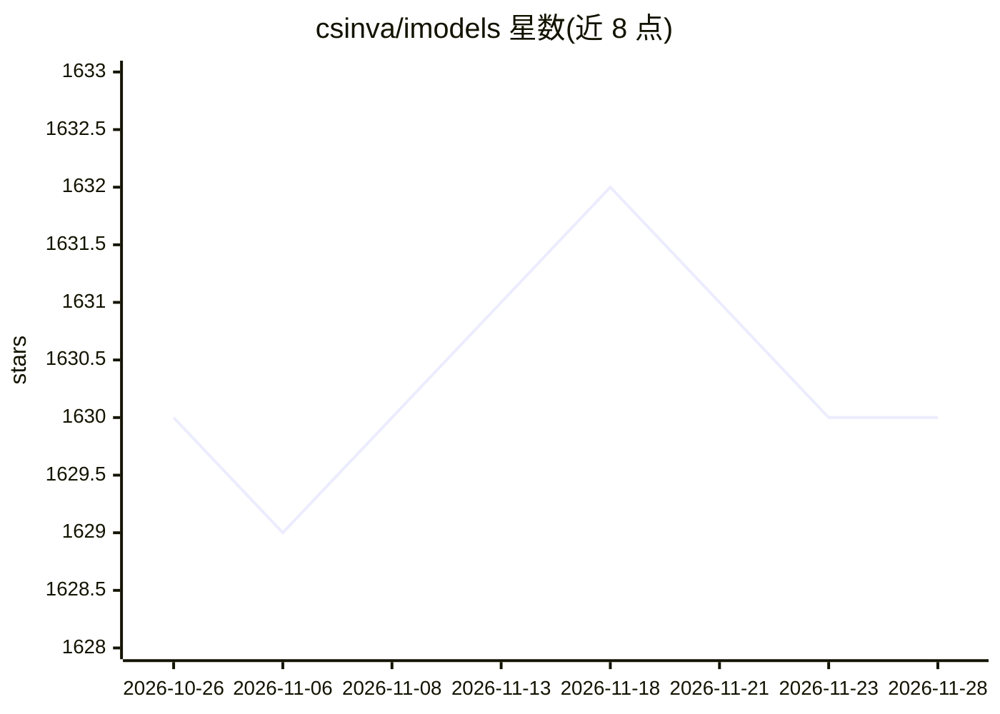

# csinva/imodels

⭐ 1,630 · Jupyter Notebook · MIT · 推送 2026-11-25 · [GitHub](https://github.com/csinva/imodels) · [官网](https://csinva.io/imodels) · 组织维护

**面向数据科学者的可解释预测建模 Python 库**

提供与 scikit-learn 兼容的可解释模型集合，覆盖规则集、规则列表、规则树与代数模型四类形式，包括 RuleFit、贝叶斯规则列表、FIGS、分层收缩等约 30 种模型。统一使用 fit/predict 接口，可嵌入 sklearn pipeline 与网格搜索；规则型模型通过 get_rules() 输出所学规则，树模型暴露特征重要度与叶节点分配。部分模型依赖 numba 或 xgboost，贝叶斯类模型速度较慢，部分分类器仅支持二分类。

## 筛选速览

| 维度 | 判定 | 备注 |
|---|---|---|
| AI 角色 | `ai-native` | 本体是模型或模型工具 |
| 许可风险 | `permissive` | MIT |
| 部署形态 | `library` | 以包/库形式分发 |
| 模型依赖 | — | README 未给出锁定关系 |
| 硬件要求 | — | 无带数字的原话,不猜 |
| 安装摩擦 | `low` | 无编译、无系统依赖或容器化 |
| 成熟度 | — | 结构信号不足 |

## 能力要点

- 约 30 种可解释模型，统一 sklearn estimator API 并有测试保障
- get_rules() 以 DataFrame 形式统一暴露规则型模型所学规则
- 分层收缩等后处理包装器可作用于任意 sklearn 树模型
- 支持 dtreeviz 绘树与特征重要度、叶节点分配检查

## 适用场景

- 用规则列表/规则树替代黑盒模型以获得可解释预测
- 在临床数据上构建临床决策规则
- 对已训练的树模型做后验解释与不确定性分析

## 场景标签

`数据分析` · 领域:效率与自动化

## 证据(README 行号)

> L13: Modern machine-learning models are increasingly complex, often making them difficult to interpret. This package pro
> L96: All of these models follow the standard sklearn estimator API, which is checked for every model in tests/model_api_

## 星数曲线

2026-10-26 1,630 → 2026-11-28 1,630（+0）

---
*卡片 v1 · prompt 1.4 · 生成 2026-11-23 · 置信度 high · 依据 README sha `e11d0bb84b2b` · [字段定义](../../DATASET.md)*
