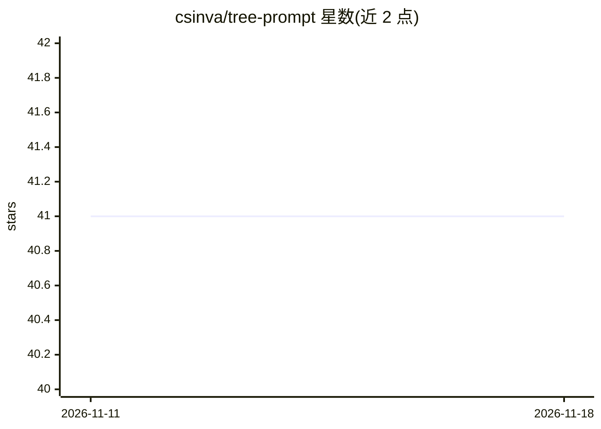

# csinva/tree-prompt

⭐ 41 · Jupyter Notebook · 推送 2026-11-11 · [GitHub](https://github.com/csinva/tree-prompt) · [官网](https://arxiv.org/abs/2310.14034) · 个人维护

**用决策树组织 prompt 的 LLM 分类库，免微调适配任务**

EMNLP 2023 论文 Tree Prompting 的官方代码：以 scikit-learn 风格接口提供 TreePromptClassifier，在保持 LLM 权重固定的前提下，用训练样本学习一棵以 prompt 化的语言模型调用作为分支决策的决策树，用于分类任务，据 README 相较基线集成有更高准确率与效率。支持通过 pip 安装，实验复现代码在独立仓库 tree-prompt-experiments 中提供。

## 筛选速览

| 维度 | 判定 | 备注 |
|---|---|---|
| AI 角色 | `ai-native` | 本体是模型或模型工具 |
| 许可风险 | `none` | — |
| 部署形态 | `library` | 以包/库形式分发 |
| 模型依赖 | — | README 未给出锁定关系 |
| 硬件要求 | — | 无带数字的原话,不猜 |
| 安装摩擦 | `low` | 无编译、无系统依赖或容器化 |
| 成熟度 | — | 结构信号不足 |

## 能力要点

- scikit-learn 风格接口的 TreePromptClassifier
- 以 prompt 化 LLM 调用作为分支决策学习决策树
- 无需微调即可适配任务，模型权重保持固定

## 适用场景

- 在不微调 LLM 的情况下提升文本分类效果
- 需要可解释/可控决策流的 LLM 分类管道
- 复现论文实验结果

## 场景标签

`提示工程` · 领域:Agent 开发

## 证据(README 行号)

> L2:  Tree Prompting: Efficient Task Adaptation without Fine-Tuning, code for the Tree-prompt paper.
> L8: Tree Prompting (EMNLP 2023) learns a decision tree whose branching decisions are prompted language-model calls, adap

## 星数曲线

2026-11-11 41 → 2026-11-18 41（+0）

---
*卡片 v1 · prompt 1.4 · 生成 2026-11-18 · 置信度 high · 依据 README sha `ee79de2712d2` · [字段定义](../../DATASET.md)*
