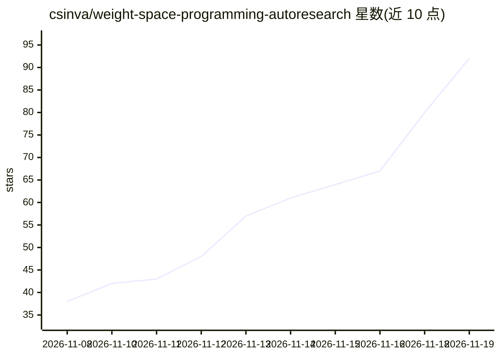

# csinva/weight-space-programming-autoresearch

⭐ 92 · Python · MIT · 推送 2026-11-16 · [GitHub](https://github.com/csinva/weight-space-programming-autoresearch) · [官网](https://arxiv.org/abs/2611.18114) · 组织维护

**LLM agent 直接编写模型权重的可解释建模研究代码库**

论文配套研究代码库：提出 iWSP 方法，由 LLM agent 以代码形式直接写出 transformer 或脑编码模型的权重与特征，全程禁止训练；每轮仅依据单一验证分数迭代修订，结束后由 LLM judge 审计并用 200 词描述重建模型以检验可读性。应用于算法任务、NLP 分类、fMRI 视觉皮层、故事聆听 fMRI 与 ECoG 音频编码。运行需 uv 与 Claude Code，通过命令行复现实验，仓库含 agent prompts 与完整日志。限制：结果依赖特定模型（Opus）运行。

## 筛选速览

| 维度 | 判定 | 备注 |
|---|---|---|
| AI 角色 | `ai-ecosystem` | LLM/agent 周边工具 |
| 许可风险 | `permissive` | MIT |
| 部署形态 | `None` |  |
| 模型依赖 | locked-api |  |
| 硬件要求 | — | 无带数字的原话,不猜 |
| 安装摩擦 | `low` | 无编译、无系统依赖或容器化 |
| 成熟度 | — | 结构信号不足 |

## 能力要点

- LLM agent 以代码手写模型权重，不允许梯度训练
- 每次迭代仅凭单个验证分数引导修订
- LLM judge 审计 + 200 词描述重建模型检验可读性
- 覆盖算法任务、NLP、fMRI、ECoG 脑编码实验并附完整运行日志

## 适用场景

- 复现论文中的可解释 transformer 与脑编码模型实验
-  neuroscience 研究者构建可读的刺激-响应编码模型
- 研究者探索免训练的 agent 驱动模型构建方法

## 场景标签

`科研工具` · 领域:学习与行业

## 证据(README 行号)

> L11:  The iWSP loop: an LLM agent writes every weight of a model in code, with no training allowed; a fixed evaluator sc
> L17: **Interpretable weight-space programming (iWSP)** takes a different route: an LLM agent builds the model by writing

## 星数曲线

2026-11-08 38 → 2026-11-19 92（+54）

---
*卡片 v1 · prompt 1.4 · 生成 2026-11-18 · 置信度 high · 依据 README sha `3c58a2c759ed` · [字段定义](../../DATASET.md)*
