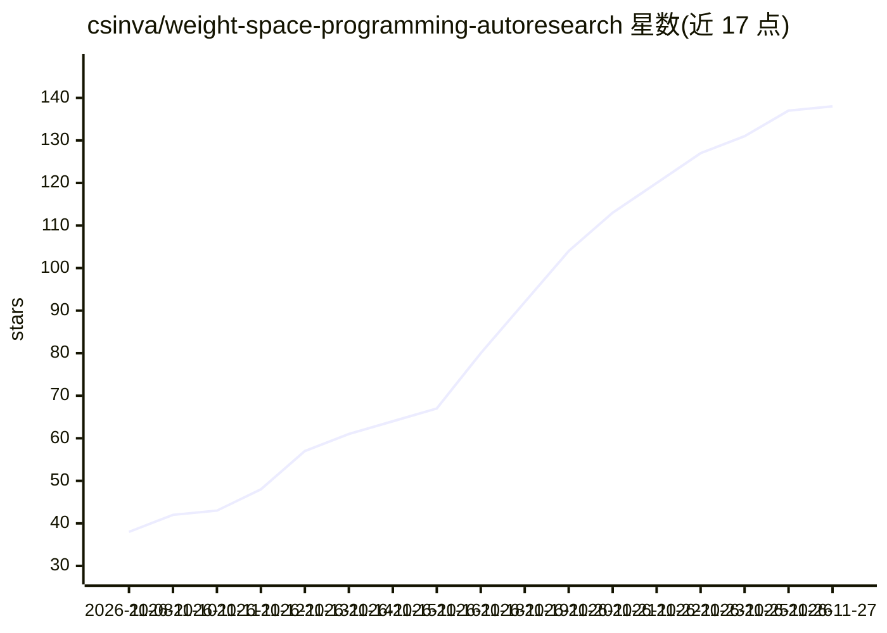

# csinva/weight-space-programming-autoresearch

⭐ 138 · Python · MIT · 推送 2026-11-23 · [GitHub](https://github.com/csinva/weight-space-programming-autoresearch) · [官网](https://arxiv.org/abs/2611.18114) · 个人维护

**让 LLM agent 以代码直接编写模型权重的科研实验代码库**

iWSP（interpretable weight-space programming）方法的配套代码库：LLM agent 不经训练、直接以代码形式编写 transformer 的权重与可解释特征，依据单一验证分数迭代保留最优版本，用于构建可读的算法任务模型、NLP 分类模型与神经科学脑编码模型。仓库提供实验框架、agent 提示词、完整运行日志与五个实验目录，附带 arXiv 论文、BibTeX 与在线报告。运行需 uv 管理环境，agent 侧依赖 Claude Code。

## 筛选速览

| 维度 | 判定 | 备注 |
|---|---|---|
| AI 角色 | `ai-native` | 本体是模型或模型工具 |
| 许可风险 | `permissive` | MIT |
| 部署形态 | `None` |  |
| 模型依赖 | locked-api |  |
| 硬件要求 | — | 无带数字的原话,不猜 |
| 安装摩擦 | `low` | 无编译、无系统依赖或容器化 |
| 成熟度 | — | 结构信号不足 |

## 能力要点

- agent 以代码手写 transformer 权重，训练流程被禁止
- 每次迭代仅向 agent 提供一个验证分数
- 提供 Claude Code 启动脚本，每次运行独立文件夹并保存全部尝试模型与对话记录
- 覆盖算法任务、NLP、fMRI、电生理、ECoG 五类实验目录

## 适用场景

- 复现论文中权重空间编程相关实验
- 研究 agent 无训练迭代构建可解释模型的方法
- 在神经科学数据上构建可读的脑编码模型

## 场景标签

`编码 Agent` `科研工具` · 领域:编码与开发

## 证据(README 行号)

> L11:  Animated overview of interpretable weight-space programming (iWSP): an LLM agent writes an interpretable brain enc
> L17: **Interpretable weight-space programming (iWSP)** takes a different route: an LLM agent builds the model by writing
> L19: This repo holds the code, agent prompts and full logs behind the paper.

## 星数曲线

2026-11-08 38 → 2026-11-27 138（+100）

---
*卡片 v1 · prompt 1.4 · 生成 2026-11-27 · 置信度 high · 依据 README sha `7d971a9a8e94` · [字段定义](../../DATASET.md)*
