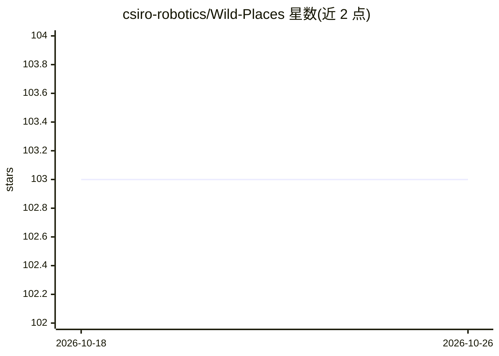

# csiro-robotics/Wild-Places

⭐ 103 · Python · NOASSERTION · 推送 2026-03-04 · [GitHub](https://github.com/csiro-robotics/Wild-Places) · [官网](https://csiro-robotics.github.io/Wild-Places/) · 组织维护

**非结构化自然环境激光雷达地点识别大规模数据集**

CSIRO 机器人团队发布的 Wild-Places 数据集及配套代码：面向非结构化自然环境（丛林等）的激光雷达地点识别（LPR）研究，含 SLAM 生成的点云子图与位姿真值，v3.0 加入强度通道并更新基准。通过 CSIRO 数据门户下载；仓库提供点云加载脚本、LoGG3D-Net 与 MinkLoc3Dv2 的训练接入说明、通用评测代码及 HuggingFace 预训练检查点。限制：K-04 序列 v2.0 曾因闭环失败暂缺。

## 筛选速览

| 维度 | 判定 | 备注 |
|---|---|---|
| AI 角色 | `ai-knowledge` | 知识聚合/清单类 |
| 许可风险 | `none` | NOASSERTION |
| 部署形态 | `None` |  |
| 模型依赖 | — | README 未给出锁定关系 |
| 硬件要求 | — | 无带数字的原话,不猜 |
| 安装摩擦 | `low` | 无编译、无系统依赖或容器化 |
| 成熟度 | — | 结构信号不足 |

## 能力要点

- 大规模非结构化自然环境 LiDAR 地点识别数据集，v3.0 更新点云与真值
- 提供 LoGG3D-Net / MinkLoc3Dv2 训练接入与预训练检查点
- 通用评测代码（跨序列/序列内场景）含 ScanContext 实现
- 含点云加载脚本与强度通道

## 适用场景

- 在自然环境中评测或训练 LiDAR 地点识别/闭环检测方法
- 获取带 SLAM 真值与 GPS 融合的大规模丛林点云数据
- 复现 ICRA2023 论文基准结果

## 场景标签

 · 领域:机器人/激光雷达感知

## 证据(README 行号)

> L21: This repository contains the code implementation used in the paper *Wild-Places: A Large-Scale Dataset for Lidar Pl
> L50: Here we provided pre-trained checkpoints and results for benchmarking several state-of-the-art LPR methods on the W

## 星数曲线

2026-10-18 103 → 2026-10-26 103（+0）

---
*卡片 v1 · prompt 1.4 · 生成 2026-10-23 · 置信度 high · 依据 README sha `8006218cf9fa` · [字段定义](../../DATASET.md)*
