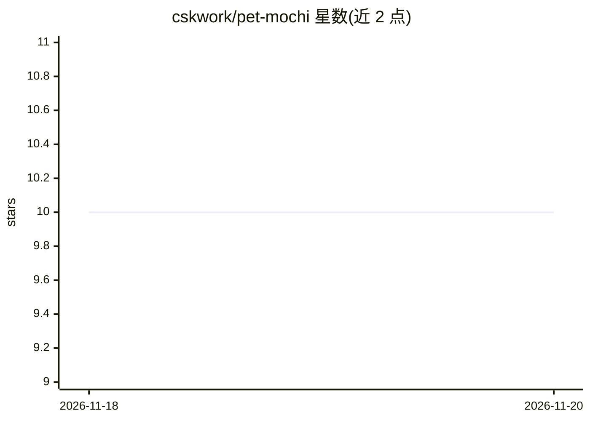

# cskwork/pet-mochi

⭐ 10 · TypeScript · MIT · 推送 2026-10-28 · [GitHub](https://github.com/cskwork/pet-mochi) · [官网](https://cskwork.github.io/pet-mochi/) · 个人维护

**桌面本地电子宠物：无 LLM 也能陪伴，聊天为可选**

基于 Tauri 2 + Svelte 5 + Rust 的桌面宠物应用，常驻桌面的透明可拖拽悬浮窗。核心是每 3 秒 tick 的确定性本地模拟，驱动情绪、需求、移动与闲置行为，完全离线可运行；LLM 仅在显著度超阈值时调用，用于短问候、日志反思与记忆抽取，默认通过 Ollama 本地推理。记忆存储于 SQLite + FTS5，按重要性×时效×置信度排序，可导出 Markdown。沙箱限制文件读写路径，需逐文件同意。从源码运行，无安装包。

## 筛选速览

| 维度 | 判定 | 备注 |
|---|---|---|
| AI 角色 | `ai-enhanced` | 去掉 AI 部分产品仍成立 |
| 许可风险 | `permissive` | MIT |
| 部署形态 | `library` | 以包/库形式分发 |
| 模型依赖 | local-ok | 支持本地模型 |
| 硬件要求 | — | 无带数字的原话,不猜 |
| 安装摩擦 | `low` | 无编译、无系统依赖或容器化 |
| 成熟度 | — | 结构信号不足 |

## 能力要点

- 确定性本地模拟驱动行为，无 LLM 时仍完整运行动画与互动
- SQLite + FTS5 记忆存储，加权排序，可导出与删除
- Ollama 本地聊天（硬冷却与离线回退），22 种精灵动画状态
- 沙箱文件访问：仅 inbox/ 读取且需逐文件同意，路径越界拒绝

## 适用场景

- 在桌面养一只离线可用的电子宠物
- 本地 Ollama 环境下与宠物进行短对话
- 不联网、不上传数据的前提下使用 AI 陪伴应用

## 场景标签

`AI 助手` · 领域:对话与助手

## 证据(README 行号)

> L37: - **Alive without the LLM.** A deterministic local simulation drives mood,
> L112: - **Optional Ollama chat** — short, mood-aware in-character replies. Hard
> L180: - Ollama is the only LLM provider implemented (`src-tauri/src/llm/ollama.rs`); without a running Ollama,

## 星数曲线

2026-11-18 10 → 2026-11-20 10（+0）

---
*卡片 v1 · prompt 1.4 · 生成 2026-11-19 · 置信度 high · 依据 README sha `2aa61416104f` · [字段定义](../../DATASET.md)*
