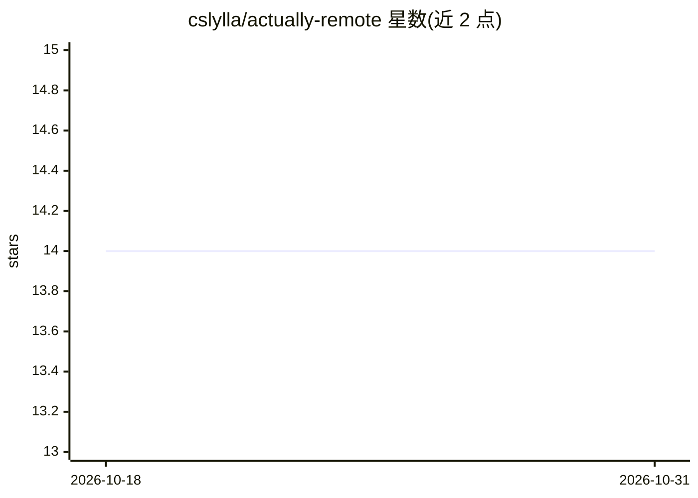

# cslylla/actually-remote

⭐ 14 · Python · MIT · 推送 2026-10-26 · [GitHub](https://github.com/cslylla/actually-remote) · 个人维护

**自托管全球远程职位监控机器人：AI 打分并每日推送匹配职位**

用户 fork 仓库后通过 GitHub Actions 每日运行的职位监控机器人：按 companies.csv 抓取目标公司招聘页，先经关键词位置过滤（免费、无 AI），再由 AI 将职位与用户 CV 比对给出匹配分与理由，超过阈值的职位经邮件（Resend）、Discord 或 Telegram 推送；默认 1/7 公司轮换抓取、优先公司每日检查，并有基于 Gemini+Google Search 的公司发现 agent。AI 提供商可插拔（Gemini/Claude/OpenAI/Ollama），免费额度下月成本为 $0。去掉 AI 仍可用位置过滤与 dry-run 验证。

## 筛选速览

| 维度 | 判定 | 备注 |
|---|---|---|
| AI 角色 | `ai-enhanced` | 去掉 AI 部分产品仍成立 |
| 许可风险 | `permissive` | MIT |
| 部署形态 | `None` |  |
| 模型依赖 | local-ok | 支持本地模型 |
| 硬件要求 | — | 无带数字的原话,不猜 |
| 安装摩擦 | `low` | 无编译、无系统依赖或容器化 |
| 成熟度 | — | 结构信号不足 |

## 能力要点

- AI CV 匹配：匹配分、理由与建议，提供商可插拔（Gemini/Claude/OpenAI/Ollama）
- 位置关键词预过滤减少 AI API 消耗，1/7 公司轮换调度、优先公司每日检查
- 邮件/Discord/Telegram 三通道通知，seen_jobs.json 去重持久化
- 公司发现 agent：Gemini+Google Search 搜索 Ashby/Greenhouse/Lever 并验证 URL

## 适用场景

- 监控非美国远程友好的目标公司招聘页并每日收推送
- 用 AI 按自己的 CV 过滤职位噪音
- 自动发现新的全球远程友好公司加入追踪列表

## 场景标签

`网页抓取` · 领域:效率与自动化

## 证据(README 行号)

> L24: 3. Each job passes through a location filter (fast, free, no AI)
> L25: 4. Matching jobs are scored against your CV by **AI** (fit score, reasons for/against)
> L36: - Location pre-filtering before AI: fast, free, reduces API usage

## 星数曲线

2026-10-18 14 → 2026-10-31 14（+0）

---
*卡片 v1 · prompt 1.4 · 生成 2026-10-31 · 置信度 high · 依据 README sha `df09e9491b5f` · [字段定义](../../DATASET.md)*
