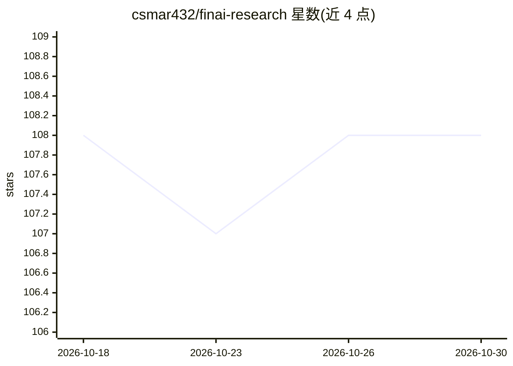

# csmar432/finai-research

⭐ 108 · Python · MIT · 推送 2026-10-26 · [GitHub](https://github.com/csmar432/finai-research) · [官网](https://csmar432.github.io/finai-research/) · 个人维护 · 中文 README

**经济学/金融研究者的 8 阶段 AI 论文工作流，产出可核验 LaTeX 草稿**

面向经济学与金融研究者的研究工作流工具：输入一句话研究主题，经想法生成→文献综述→新颖性验证→实证设计→数据获取→分析→写作→对抗性 Review 八阶段流水线，每阶段需研究者确认。内置 43 个 MCP 数据源（A股/美股/宏观/学术论文，28 个免 Key）、58 个计量模块（DID/IV/RDD/合成控制等）、18 个 AI 技能与 30 种期刊 LaTeX 模板；Mock 数据默认禁用，AI 结果需研究者核实。以 PyPI 包与源码两种方式安装，支持 macOS/Linux/Windows。

## 筛选速览

| 维度 | 判定 | 备注 |
|---|---|---|
| AI 角色 | `ai-native` | 本体是模型或模型工具 |
| 许可风险 | `permissive` | MIT |
| 部署形态 | `self-host` | docker 或自建部署 |
| 模型依赖 | locked-api |  |
| 硬件要求 | — | 无带数字的原话,不猜 |
| 安装摩擦 | `low` | 无编译、无系统依赖或容器化 |
| 成熟度 | — | 结构信号不足 |

## 能力要点

- 8 阶段流水线，每阶段需研究者检查点确认（human-in-the-loop）
- 43 个 MCP 数据源（28 个无需 API Key），覆盖 A 股/美股/宏观/OpenAlex
- 58 个计量模块含标准/交错 DID、IV、RDD、合成控制、面板 GMM 与 19 类稳健性检验
- 30 种期刊 LaTeX 模板，中英日德四种语言（JF/JFE/RFS/经济研究/管理世界等）

## 适用场景

- 博士生/研究者设计实证研究并生成期刊格式的 LaTeX 草稿
- 自动化文献综述与因果识别策略设计
- 接入 A 股与宏观数据源跑 DID/IV/RDD 回归与稳健性检验

## 场景标签

`科研工具` `金融量化` · 领域:学习与行业

## 证据(README 行号)

> L47: **一次输入 → 8 阶段流水线：想法生成 → 文献综述 → 新颖性验证 → 实证设计 → 数据获取 → 分析 → 论文写作 → 对抗性 Review。每阶段需研究者确认。**
> L93: |**PhD students / researchers**|Design empirical studies, run econometric analysis, generate LaTeX manuscripts for 
> L191: 帮我研究关税政策对A股出口型企业创新的影响，设计一篇发表在经济研究的实证论文

## 星数曲线

2026-10-18 108 → 2026-10-30 108（+0）

---
*卡片 v1 · prompt 1.4 · 生成 2026-10-23 · 置信度 mid · 依据 README sha `ebf0b9fdb593` · [字段定义](../../DATASET.md)*
