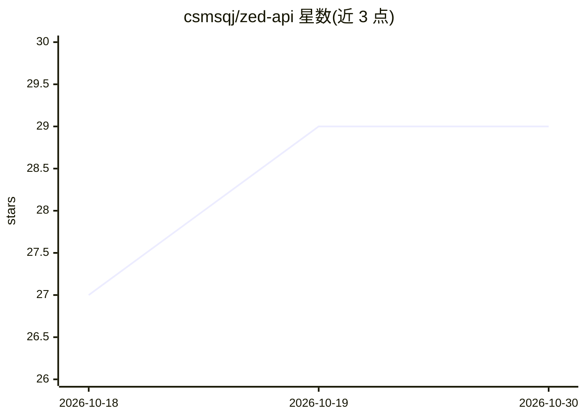

# csmsqj/zed-api

⭐ 29 · Zig · MIT · 推送 2026-09-27 · [GitHub](https://github.com/csmsqj/zed-api) · 个人维护 · 中文 README

**把 Zed 托管模型转为本地 OpenAI/Anthropic 兼容 API 的代理**

用 Zig 实现的本地代理服务：将 Zed 云端托管的模型（GPT-5.6 各变体、Claude Sonnet 5）转换为 OpenAI Responses / Chat Completions 与 Anthropic Messages 三种协议接口，均支持流式与工具调用，使 Codex、Claude Code、OpenCode 可直连本机 127.0.0.1:8001 使用。内置多账号调度（按失败类型冷却、自动换号）、账号额度/套餐管理页，并针对 Zed 上游解析器的严格校验做字段清洗。已知限制：服务无鉴权仅限本机、上游协议可能变更、跨轮思考仅在 Responses 链路保留。Windows 提供可执行文件，macOS 需 Zig + npm 自行构建。

## 筛选速览

| 维度 | 判定 | 备注 |
|---|---|---|
| AI 角色 | `ai-ecosystem` | LLM/agent 周边工具 |
| 许可风险 | `permissive` | MIT |
| 部署形态 | `desktop` | 安装包/桌面程序 |
| 模型依赖 | — | README 未给出锁定关系 |
| 硬件要求 | — | 无带数字的原话,不猜 |
| 安装摩擦 | `low` | 无编译、无系统依赖或容器化 |
| 成熟度 | — | 结构信号不足 |

## 能力要点

- 三种协议（Responses/Chat Completions/Messages）均支持流式与工具调用
- 多账号调度：认证失败/限流/网络错误分别冷却并自动换号
- 针对 Zed 上游严格解析的字段清洗与错误形态识别
- 中文 Web 管理页：套餐、额度、模型探测、健康检查

## 适用场景

- 让 Codex / Claude Code / OpenCode 连接本机代理使用 Zed 托管模型
- 多账号轮换调度并查看各账号额度与套餐状态
- 排查上游 400 报错时的字段级清洗与转发

## 场景标签

`模型网关` · 领域:Agent 开发

## 证据(README 行号)

> L3: 把 Zed 托管的模型转成本地 OpenAI / Anthropic 接口，让 **Codex、Claude Code、OpenCode** 直接连本机用。
> L5: 三种协议（Responses / Chat Completions / Messages）都支持流式和工具调用，自带多账号调度、额度查看和中文 Web 管理页。
> L143: |方法|路径|作用|

## 星数曲线

2026-10-18 27 → 2026-10-30 29（+2）

---
*卡片 v1 · prompt 1.4 · 生成 2026-10-26 · 置信度 high · 依据 README sha `50886eda7162` · [字段定义](../../DATASET.md)*
