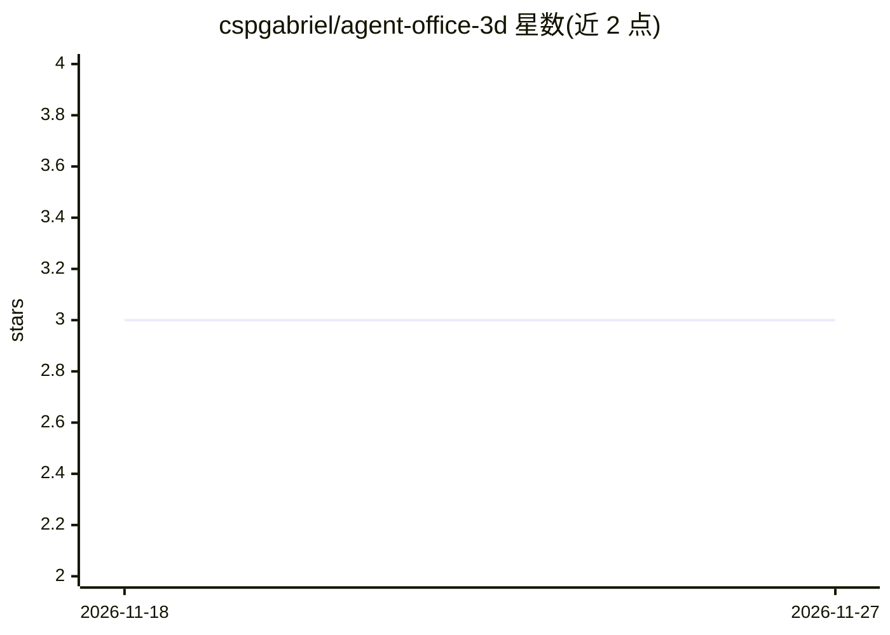

# cspgabriel/agent-office-3d

⭐ 3 · JavaScript · MIT · 推送 2026-10-23 · [GitHub](https://github.com/cspgabriel/agent-office-3d) · [官网](https://cspgabriel.github.io/agent-office-3d/) · 个人维护

**把 Multica 工作区 AI agent 可视化为 3D 办公室的管理面板**

基于 Node.js 与 three.js 的 Web 面板：将 Multica 工作区中的每个 agent 映射为里约海滨屋顶办公室里的角色，按任务运行状态在工位、会议室、宿舍（定时任务等待）与 pending 房间（被阻塞）间移动。同一界面可发起任务、聊天、召集会议、管理 issue 与查看执行历史，状态约 2 秒内更新（轮询加 SSE）。无数据库、无构建步骤、无 npm 依赖；支持 demo 模式在无 Multica 工作区时浏览；界面当前为巴西葡萄牙语。

## 筛选速览

| 维度 | 判定 | 备注 |
|---|---|---|
| AI 角色 | `ai-ecosystem` | LLM/agent 周边工具 |
| 许可风险 | `permissive` | MIT |
| 部署形态 | `None` |  |
| 模型依赖 | — | README 未给出锁定关系 |
| 硬件要求 | — | 无带数字的原话,不猜 |
| 安装摩擦 | `low` | 无编译、无系统依赖或容器化 |
| 成熟度 | `idea` | |

## 能力要点

- agent 状态映射为 3D 场景：工位、会议室、宿舍与 pending 房间
- 约 2 秒状态更新（轮询 + Server-Sent Events）
- 支持定时任务管理、会议召集与 issue 全文搜索/批量操作
- 无数据库、无构建步骤、无 npm 依赖，demo 模式无需 Multica

## 适用场景

- 在一个界面里查看和管理团队所有 agent 的任务与运行历史
- 给 agent 排定时任务并通过 3D 场景观察其执行状态
- 在不接入真实工作区的情况下用 demo 模式演示面板

## 场景标签

`多智能体` · 领域:Agent 开发

## 证据(README 行号)

> L3: **A live 3D office for your AI agents.** Every agent in a Multica workspace becomes a person in a rooftop office on 
> L80: - `server.mjs` — reads the workspace through the `multica` CLI (`--output json`), builds a sanitized snapshot (emai

## 星数曲线

2026-11-18 3 → 2026-11-27 3（+0）

---
*卡片 v1 · prompt 1.4 · 生成 2026-11-22 · 置信度 high · 依据 README sha `3b1e29715d29` · [字段定义](../../DATASET.md)*
