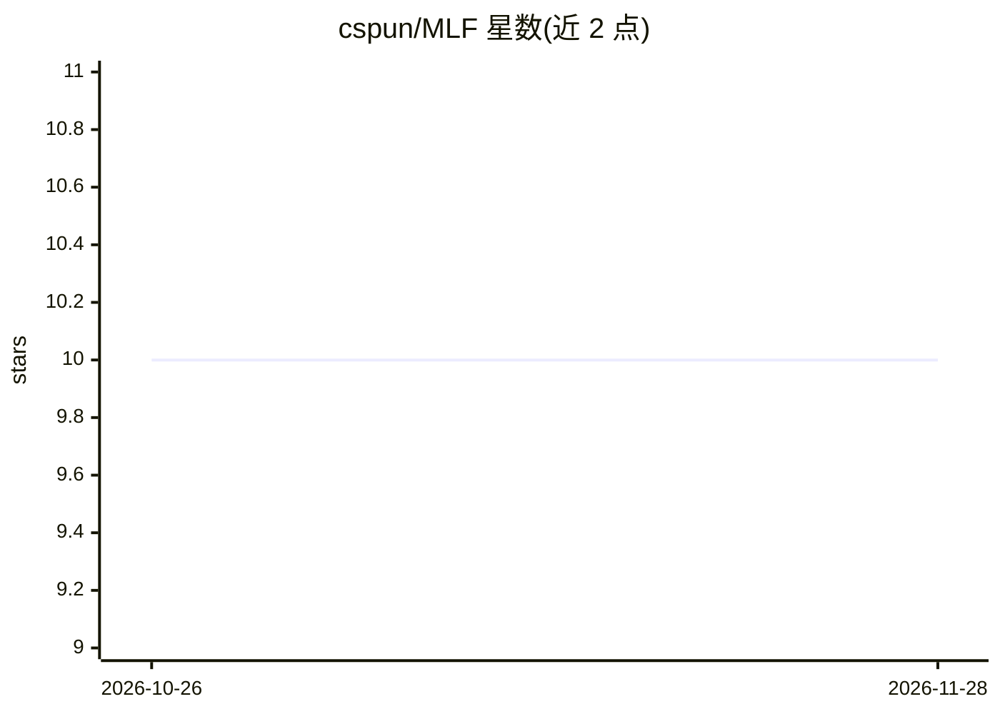

# cspun/MLF

⭐ 10 · Jupyter Notebook · 推送 2026-03-11 · [GitHub](https://github.com/cspun/MLF) · [官网](https://personal.ntu.edu.sg/cspun/) · 组织维护

**南洋理工《金融机器学习》课程的实验课笔记合集**

存储 Patrick PUN Chi Seng 在南洋理工大学讲授的《Machine Learning in Finance (MLF)》课程实验笔记，内容参照 statlearning.com 的资源并按课程定制。按主题组织为聚类、降维、KNN 与重采样、回归与正则化、逻辑回归、决策树与集成、SVM、前馈网络、LSTM、CNN 等 10 个单元，各单元提供课程页面链接。仓库本身不含安装或运行说明。

## 筛选速览

| 维度 | 判定 | 备注 |
|---|---|---|
| AI 角色 | `ai-knowledge` | 知识聚合/清单类 |
| 许可风险 | `none` | — |
| 部署形态 | `None` |  |
| 模型依赖 | — | README 未给出锁定关系 |
| 硬件要求 | — | 无带数字的原话,不猜 |
| 安装摩擦 | `low` | 无编译、无系统依赖或容器化 |
| 成熟度 | — | 结构信号不足 |

## 能力要点

- 覆盖无监督、监督学习与深度学习共 10 个单元的实验笔记
- 参照 statlearning.com 资源并按 MLF 课程定制
- 各单元附课程页面链接

## 适用场景

- 查阅金融机器学习课程的实验实现笔记
- 按单元查找聚类、回归、SVM、LSTM 等方法的课程资料

## 场景标签

`教程课程` · 领域:学习与行业

## 证据(README 行号)

> L1: This repository stores all the lab notes for implementing the methods covered in "Machine Learning in Finance (MLF)"
> L3: Most of them refer to the resources in https://www.statlearning.com/ with some customization to the MLF module.

## 星数曲线

2026-10-26 10 → 2026-11-28 10（+0）

---
*卡片 v1 · prompt 1.4 · 生成 2026-11-19 · 置信度 high · 依据 README sha `25d863f77237` · [字段定义](../../DATASET.md)*
