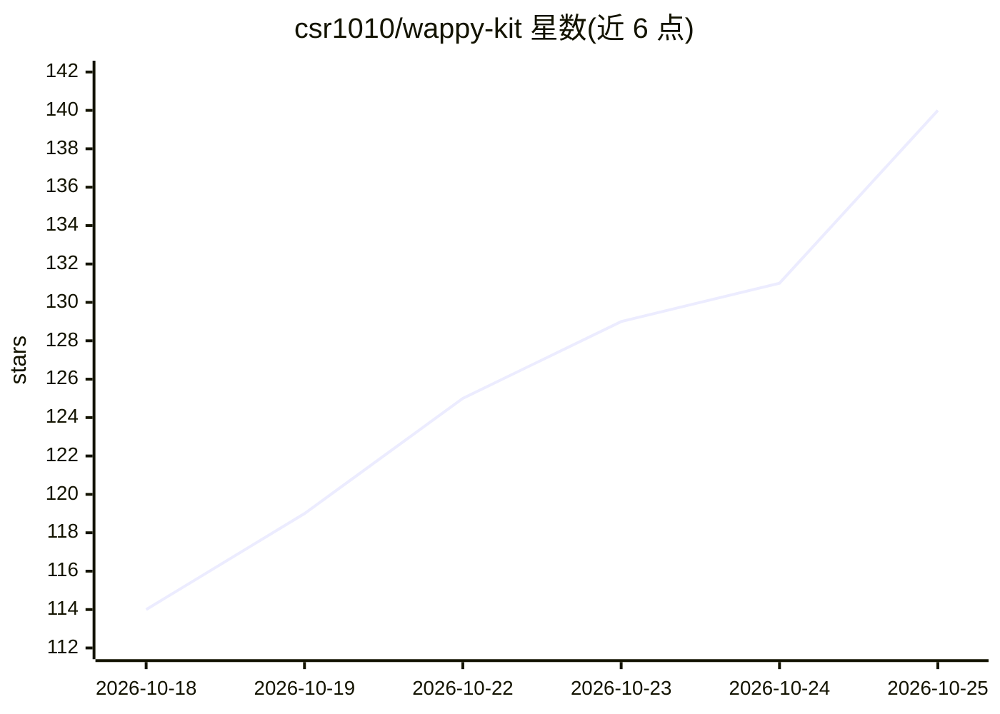

# csr1010/wappy-kit

⭐ 143 · TypeScript · MIT · 推送 2026-10-24 · [GitHub](https://github.com/csr1010/wappy-kit) · [官网](https://github.com/csr1010/wappy-kit#readme) · 个人维护

**本地优先的开源 WhatsApp AI agent SDK，自带模型与号码**

TypeScript 编写的 AI agent SDK，通过 npm create 脚手架生成可在本机运行的 WhatsApp agent 项目：自带记忆/RAG 层（默认本地 SQLite/LibSQL + BM25，可选自托管或云端 Cognee 知识图谱）、工具调用框架与 webhook 服务器，数据不经作者服务器。模型接入 OpenAI/Anthropic/Gemini API key，或完全离线跑本地 Ollama。附 Gmail/Calendar 只读工具示例。需 Node.js 22+ 与 Meta WhatsApp Cloud API 应用；自述处于 pre-1.0 早期阶段。

## 筛选速览

| 维度 | 判定 | 备注 |
|---|---|---|
| AI 角色 | `ai-ecosystem` | LLM/agent 周边工具 |
| 许可风险 | `permissive` | MIT |
| 部署形态 | `library` | 以包/库形式分发 |
| 模型依赖 | local-ok | 支持本地模型 |
| 硬件要求 | — | 无带数字的原话,不猜 |
| 安装摩擦 | `low` | 无编译、无系统依赖或容器化 |
| 成熟度 | `idea` | |

## 能力要点

- npm create 一条命令生成可运行的 WhatsApp agent 项目，本地优先
- 内置记忆/RAG 层：默认 SQLite/LibSQL+BM25 离线，可选 Cognee 知识图谱后端
- 模型接入 OpenAI/Anthropic/Gemini 或本地 Ollama 全离线运行
- 提供 Gmail/Calendar 参数化只读工具示例与 webhook 服务器

## 适用场景

- 在 WhatsApp 上跑一个记得住上下文的个人助理
- 接入自己的 Google 账号用自然语言查日历和邮件
- 搭客服/预约/内部运维 bot，接入自有业务系统
- 自建私有知识库问答，数据不出本机

## 场景标签

`Agent 框架` `RAG` · 领域:Agent 开发

## 证据(README 行号)

> L31: npm create @wappy_ai/agent
> L102: |`@wappy_ai/harness`|The agent itself: how it thinks, remembers, and decides what to do.|
> L117: - **A model API key.** OpenAI, Anthropic, or Gemini. Or skip it entirely and run fully offline against local Ollam

## 星数曲线

2026-10-18 114 → 2026-10-25 140（+26）

---
*卡片 v1 · prompt 1.4 · 生成 2026-10-23 · 置信度 high · 依据 README sha `5d9a97efdd42` · [字段定义](../../DATASET.md)*
