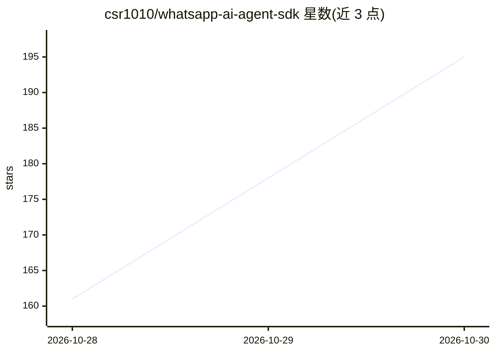

# csr1010/whatsapp-ai-agent-sdk

⭐ 195 · TypeScript · MIT · 推送 2026-10-29 · [GitHub](https://github.com/csr1010/whatsapp-ai-agent-sdk) · [官网](https://github.com/csr1010/wappy-kit#readme) · 个人维护

**在本地构建和运行 WhatsApp AI agent 的开源 SDK**

TypeScript SDK，用于在开发者自己的机器上构建、定制和部署 WhatsApp AI agent。通过 npm create 脚手架生成项目，自带记忆/上下文/工具调用/回复格式化的 agent 本体；模型密钥、WhatsApp 号码与数据均由用户自带，数据保存在本地单一文件，不经维护方服务器。记忆后端默认本地 SQLite/LibSQL+BM25，可选 Cognee 知识图谱；提供 Gmail/Calendar 只读工具示例。需 Node.js 22+、WhatsApp Cloud API 应用和模型 API 密钥，或用本地 Ollama 完全离线运行。自述处于 pre-1.0 早期阶段。

## 筛选速览

| 维度 | 判定 | 备注 |
|---|---|---|
| AI 角色 | `ai-ecosystem` | LLM/agent 周边工具 |
| 许可风险 | `permissive` | MIT |
| 部署形态 | `library` | 以包/库形式分发 |
| 模型依赖 | local-ok | 支持本地模型 |
| 硬件要求 | — | 无带数字的原话,不猜 |
| 安装摩擦 | `low` | 无编译、无系统依赖或容器化 |
| 成熟度 | `idea` | |

## 能力要点

- npm create 脚手架一条命令生成可运行的 WhatsApp agent 项目
- 默认本地记忆后端（SQLite/LibSQL + BM25），完全离线零配置
- 可选 Cognee 知识图谱后端与 Gmail/Calendar 只读工具示例
- 数据本地存储，不经维护方服务器，模型/号码/数据自带

## 适用场景

- 搭一个能记住长期上下文的个人 WhatsApp 助理
- 接入自己的 Google 账号，用自然语言查日历和邮件
- 为餐厅/诊所等搭接自有预订系统的客服 agent
- 基于自己的笔记文档搭私有的 RAG 问答

## 场景标签

`Agent 框架` `RAG` · 领域:Agent 开发

## 证据(README 行号)

> L10:  Build your own WhatsApp AI agent: an open-source SDK to build, customize and deploy AI agents on WhatsApp in minut
> L104: |`@wappy_ai/harness`|The agent itself: how it thinks, remembers, and decides what to do.|

## 星数曲线

2026-10-28 161 → 2026-10-30 195（+34）

---
*卡片 v1 · prompt 1.4 · 生成 2026-10-28 · 置信度 high · 依据 README sha `bb81d3396943` · [字段定义](../../DATASET.md)*
