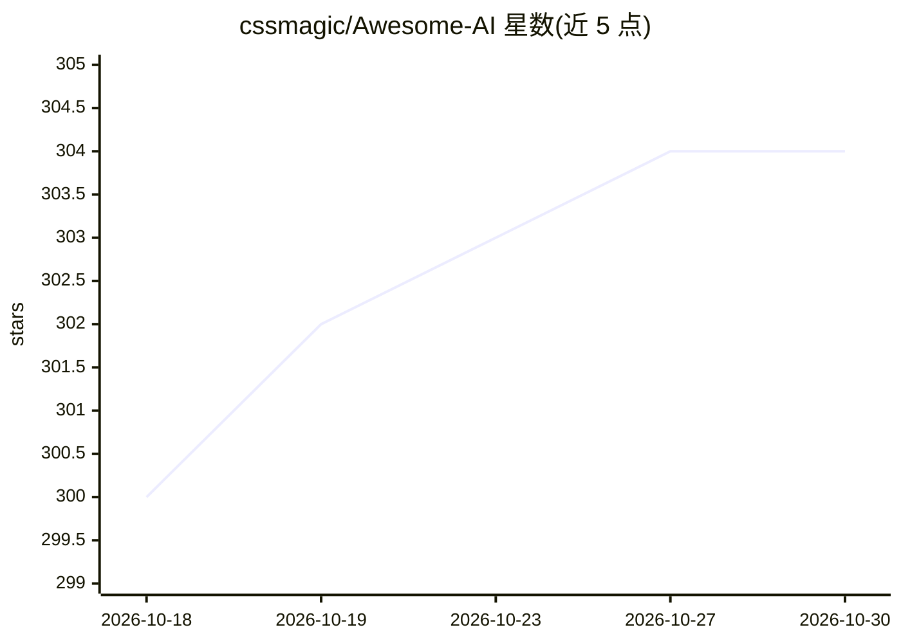

# cssmagic/Awesome-AI

⭐ 304 · 推送 2026-10-29 · [GitHub](https://github.com/cssmagic/Awesome-AI) · 个人维护 · 中文 README

**生成式 AI 资料清单：汇总 LLM、AI 编程、绘画音视频工具入口**

中文维护的生成式 AI 资料聚合清单，按大型语言模型、AI 编程、AI 绘画/音频视频创作、在线 SD 绘画、音乐创作等章节组织，条目覆盖 OpenAI/Anthropic/Google/DeepSeek/智谱/Kimi 等模型厂商的官网、API 文档、定价与 Web 产品入口，以及 Copilot、Cursor 等编程工具和绘画、视频、TTS、数字人相关产品与开源项目，多为简介加链接形式，标注持续更新。面向想了解生成式 AI 应用与开发资源的使用者，本身不提供代码或安装方式。

## 筛选速览

| 维度 | 判定 | 备注 |
|---|---|---|
| AI 角色 | `ai-knowledge` | 知识聚合/清单类 |
| 许可风险 | `none` | — |
| 部署形态 | `None` |  |
| 模型依赖 | — | README 未给出锁定关系 |
| 硬件要求 | — | 无带数字的原话,不猜 |
| 安装摩擦 | `low` | 无编译、无系统依赖或容器化 |
| 成熟度 | — | 结构信号不足 |

## 能力要点

- 按 6 大类组织条目，覆盖模型、编程工具、绘画、视频、3D、TTS、数字人等方向
- 每个条目附官网、API 文档、定价与 Web 产品入口等链接
- 收录国内外主流与国产模型/工具（DeepSeek、智谱 GLM、Kimi、通义千问等）

## 适用场景

- 查找主流大模型厂商的 API 文档与定价入口
- 对比 AI 辅助编程工具与编辑器插件
- 发现 AI 绘画、视频生成、TTS、数字人等创作工具

## 场景标签

`精选清单` · 领域:学习与行业

## 证据(README 行号)

> L3: 收集分享 AI 大型语言模型 (LLM)、AI 辅助编程、AI 绘画等领域的常用资料，探索生成式人工智能的应用与开发。
> L5: > ### 目录

## 星数曲线

2026-10-18 300 → 2026-10-30 304（+4）

---
*卡片 v1 · prompt 1.4 · 生成 2026-10-22 · 置信度 mid · 依据 README sha `4970ec9c3012` · [字段定义](../../DATASET.md)*
