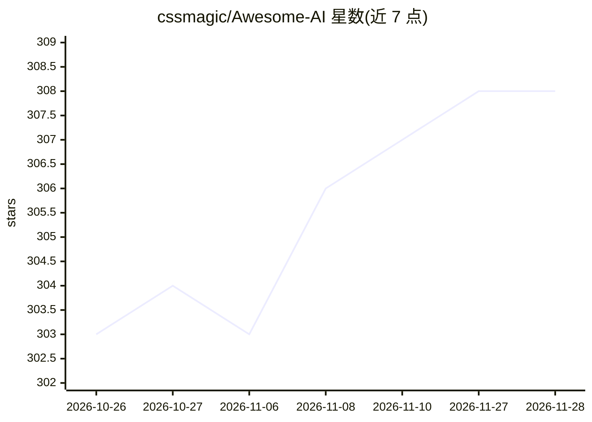

# cssmagic/Awesome-AI

⭐ 308 · 推送 2026-11-25 · [GitHub](https://github.com/cssmagic/Awesome-AI) · 个人维护 · 中文 README

**面向中文用户的生成式 AI 资源清单：模型、编程、绘画工具导航**

以条目列表形式组织的大模型相关资料汇总，按大型语言模型、AI 编程、AI 绘画/音频视频创作、常用 AI 网站与工具等类别分章。每个条目提供简介、官网、API 文档链接与定价信息，覆盖国内外多家模型厂商及编辑器插件、终端 Agent、网页生成工具等。声明持续更新，并提示用户用浏览器搜索定位关键词。仓库本身不提供代码或服务，仅收录第三方资源链接与说明。

## 筛选速览

| 维度 | 判定 | 备注 |
|---|---|---|
| AI 角色 | `ai-knowledge` | 知识聚合/清单类 |
| 许可风险 | `none` | — |
| 部署形态 | `library` | 以包/库形式分发 |
| 模型依赖 | — | README 未给出锁定关系 |
| 硬件要求 | — | 无带数字的原话,不猜 |
| 安装摩擦 | `low` | 无编译、无系统依赖或容器化 |
| 成熟度 | — | 结构信号不足 |

## 能力要点

- 按大语言模型、AI 编程、AI 绘画/音视频等类别组织的条目清单
- 条目含官网、API 文档与定价链接
- 覆盖国内外多家模型厂商与 AI 编程工具
- 声明持续更新中

## 适用场景

- 查找大模型产品的官网、API 文档与定价入口
- 浏览 AI 编程工具生态并对比产品形态与套餐
- 了解国产大模型与编辑器插件的收录情况

## 场景标签

`精选清单` · 领域:学习与行业

## 证据(README 行号)

> L3: 收集分享 AI 大型语言模型 (LLM)、AI 辅助编程、AI 绘画等领域的常用资料，探索生成式人工智能的应用与开发。
> L5: > ### 目录
> L13: > 🔍 提醒：善用搜索，按 Ctrl+F 或 ⌘F 定位到你想找的关键词。

## 星数曲线

2026-10-26 303 → 2026-11-28 308（+5）

---
*卡片 v1 · prompt 1.4 · 生成 2026-11-26 · 置信度 mid · 依据 README sha `b0ccc95ac167` · [字段定义](../../DATASET.md)*
