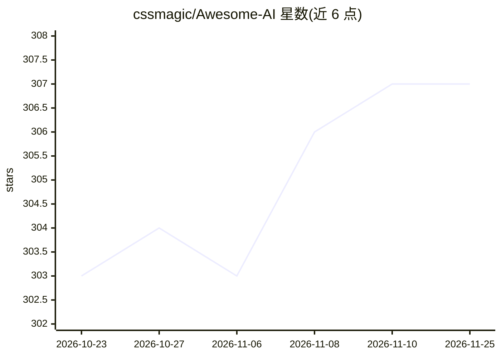

# cssmagic/Awesome-AI

⭐ 307 · 推送 2026-11-23 · [GitHub](https://github.com/cssmagic/Awesome-AI) · 个人维护 · 中文 README

**面向 AI 使用者的中文资料清单：LLM、AI 编程与绘画工具导航**

以目录形式组织的中文 AI 资料聚合清单，覆盖大型语言模型、AI 编程、AI 绘画/音视频创作、常用 AI 网站与常见问题等板块。每个条目提供简介、官网、API 文档链接与套餐定价信息，持续更新，建议用浏览器搜索定位关键词。以 Markdown README 形式发布，无代码、无安装运行环节，主要面向需要了解和选用 AI 产品的读者。

## 筛选速览

| 维度 | 判定 | 备注 |
|---|---|---|
| AI 角色 | `ai-knowledge` | 知识聚合/清单类 |
| 许可风险 | `none` | — |
| 部署形态 | `library` | 以包/库形式分发 |
| 模型依赖 | — | README 未给出锁定关系 |
| 硬件要求 | — | 无带数字的原话,不猜 |
| 安装摩擦 | `low` | 无编译、无系统依赖或容器化 |
| 成熟度 | — | 结构信号不足 |

## 能力要点

- 收录多家大模型的官网、API 文档与定价链接
- AI 编程板块覆盖 CLI、IDE 插件、编辑器与终端 Agent 等形态
- 包含国产大模型与国产编程助手的专门条目
- 提供绘画/音视频创作工具的套餐定价整理

## 适用场景

- 想了解各大模型和 AI 产品的入口与定价
- 挑选适合自己的 AI 编程工具
- 查找国产大模型的 API 文档链接

## 场景标签

`精选清单` · 领域:学习与行业

## 证据(README 行号)

> L1: # Awesome AI
> L3: 收集分享 AI 大型语言模型 (LLM)、AI 辅助编程、AI 绘画等领域的常用资料，探索生成式人工智能的应用与开发。
> L16: ## 大型语言模型

## 星数曲线

2026-10-23 303 → 2026-11-25 307（+4）

---
*卡片 v1 · prompt 1.4 · 生成 2026-11-25 · 置信度 mid · 依据 README sha `25e86c795770` · [字段定义](../../DATASET.md)*
