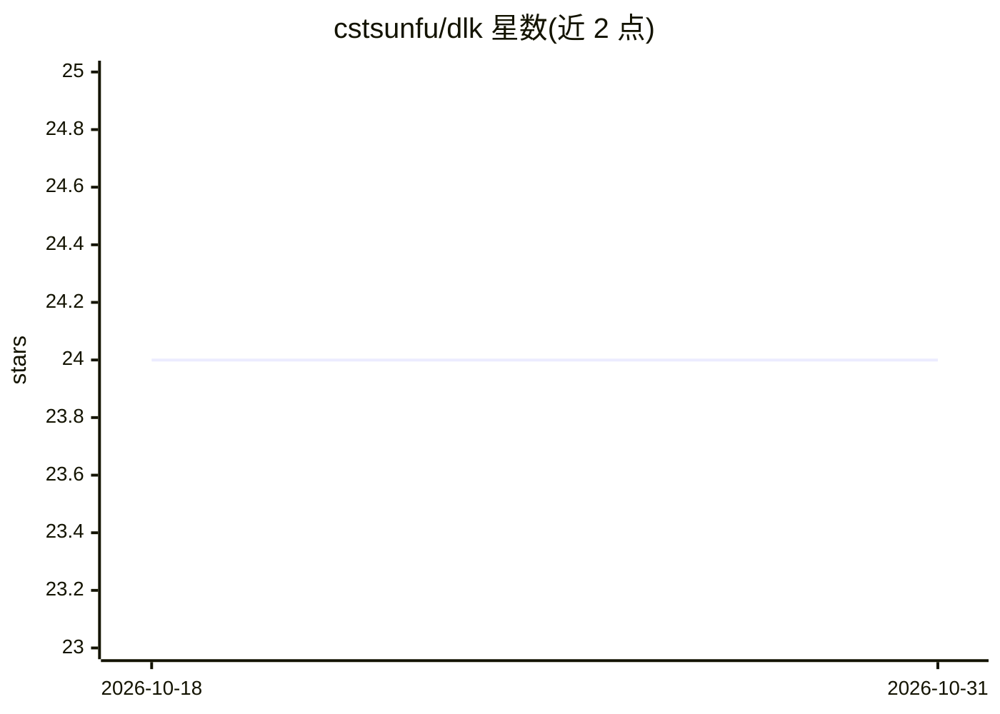

# cstsunfu/dlk

⭐ 24 · Python · Apache-2.0 · 推送 2026-03-05 · [GitHub](https://github.com/cstsunfu/dlk) · 个人维护 · 中文 README

**基于 PyTorch/Lightning 的任务导向深度学习一站式开发框架**

DLK 以 lightning 的 Trainer 为训练核心、intc 为 config 管理系统，将模型训练、参数与架构搜索、预测、部署（dlk.server.Server）和 demo（streamlit）整合为一份代码、一份配置（process.jsonc 与 fit.jsonc 各阶段复用）。内置对抗训练方法（fgm/free_lb 等）、callback、多 scheduler 与 multi_loss、参考 fairseq 的多种 token_sample 文本生成控制，并提供 grid search、NER、关系抽取、图像分类、image caption、摘要等任务示例。采用双层模块注册机制（intc cregister + dlk register）支持任意位置扩展组件。

## 筛选速览

| 维度 | 判定 | 备注 |
|---|---|---|
| AI 角色 | `ai-ecosystem` | LLM/agent 周边工具 |
| 许可风险 | `permissive` | Apache-2.0 |
| 部署形态 | `library` | 以包/库形式分发 |
| 模型依赖 | — | README 未给出锁定关系 |
| 硬件要求 | — | 无带数字的原话,不猜 |
| 安装摩擦 | `low` | 无编译、无系统依赖或容器化 |
| 成熟度 | — | 结构信号不足 |

## 能力要点

- 训练/搜索/预测/部署/demo 复用同一份代码与配置
- 基于 intc 的模块级架构搜索能力
- 内置 embedding 对抗训练方法（fgm、free_lb 等）
- 双层模块注册机制支持组件任意扩展

## 适用场景

- 快速开发并部署任务导向的深度学习模型
- 对超参数和模型架构进行网格搜索
- 用 streamlit 快速搭建训练模型的演示 demo

## 场景标签

`模型训练` · 领域:训练与推理

## 证据(README 行号)

> L25: `DLK`是一个使用`lightning`的`Trainer`，`intc`为`config`管理系统的集模型训练、参数（架构）搜索、模型预测、模型部署和`demo`为一身，对于同一个模型实现这些功能只需要依赖一份代码，大大降低开
> L96: 模型训练pipeline对应的内置入口是`dlk.train.Train`, 我们需要编写`fit.jsonc` config文件来对模型训练（推理和deploy过程也同样复用这个文件），使用配置文件初始化`Train`之后执行`

## 星数曲线

2026-10-18 24 → 2026-10-31 24（+0）

---
*卡片 v1 · prompt 1.4 · 生成 2026-10-27 · 置信度 high · 依据 README sha `2f089924591e` · [字段定义](../../DATASET.md)*
