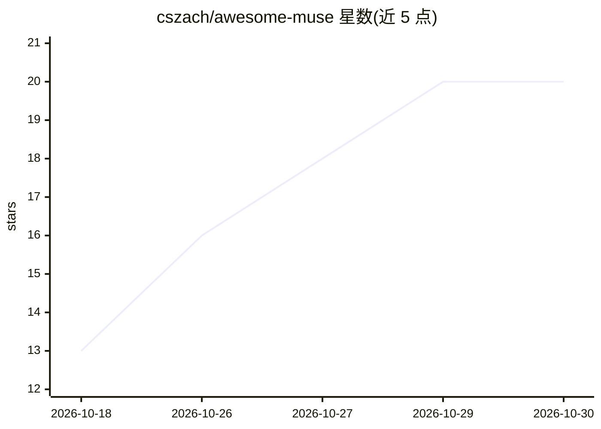

# cszach/awesome-muse

⭐ 20 · CC0-1.0 · 推送 2026-10-28 · [GitHub](https://github.com/cszach/awesome-muse) · 个人维护

**Meta Muse 个人 AI 助手的社区策展资源清单**

社区维护的非官方 awesome 清单，收录围绕 Meta 个人 AI 助手 Muse 的指南、用例、工具与新闻：入门与下载链接、使用技巧、连接器与集成、社区开源工具、基于 Gadget SDK 的硬件移植项目（ESP32、手表、眼镜、路由器等）以及隐私安全报道。条目为人工挑选而非穷尽，标注 Meta 官方来源，并提示接入第三方工具前先审查代码与权限。清单本身不含可安装的软件。

## 筛选速览

| 维度 | 判定 | 备注 |
|---|---|---|
| AI 角色 | `ai-knowledge` | 知识聚合/清单类 |
| 许可风险 | `viral` | CC0-1.0 |
| 部署形态 | `None` |  |
| 模型依赖 | — | README 未给出锁定关系 |
| 硬件要求 | — | 无带数字的原话,不猜 |
| 安装摩擦 | `low` | 无编译、无系统依赖或容器化 |
| 成熟度 | `idea` | |

## 能力要点

- 覆盖指南、用例、连接器、社区工具与硬件移植等多类资源
- 收录 1,078+ 真实 Muse 构建的目录与 150+ 用例合集
- 包含大量基于 Gadget SDK 的开源硬件项目（ESP32、Apple Watch、Ray-Ban 眼镜等）
- 以🎖️标注 Meta 官方资源，并声明与 Meta 无隶属关系

## 适用场景

- 刚开始使用 Muse 时查找入门指南与官方下载入口
- 为 Muse 寻找连接器、技能与社区开源工具
- 了解 Muse 在隐私与安全方面的公开报道和讨论

## 场景标签

`精选清单` · 领域:学习与行业

## 证据(README 行号)

> L3: > A curated list of the best guides, use cases, tools, and news for Muse, Meta's personal AI agent.
> L22: Muse is a personal AI agent that acts on goals you describe in plain language, using a browser and your connected a

## 星数曲线

2026-10-18 13 → 2026-10-30 20（+7）

---
*卡片 v1 · prompt 1.4 · 生成 2026-10-28 · 置信度 high · 依据 README sha `09cd838f09a0` · [字段定义](../../DATASET.md)*
