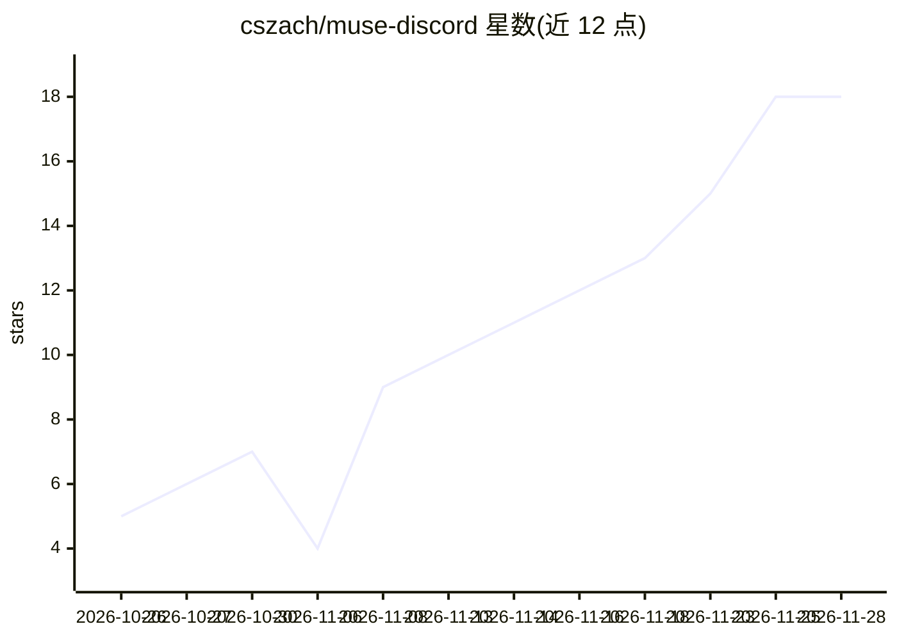

# cszach/muse-discord

⭐ 18 · Python · MIT · 推送 2026-11-27 · [GitHub](https://github.com/cszach/muse-discord) · 个人维护

**把 Muse AI 伙伴接入 Discord 的机器人**

将 muse.ai 的 Muse AI 伙伴部署为 Discord 机器人：可回复 DM 与服务器消息、读取图片/视频/PDF/文本附件、生成图像与视频、设置提醒与监听关键词，并具备主动联系用户的机制。通过自然语言或 /settings 自定义行为，支持插件系统扩展；提供按 DM/服务器/频道细分的权限矩阵。安装方式为让 Muse 依照仓库内 SETUP.md 引导完成配置，新版本通过机器人 DM 通知更新。

## 筛选速览

| 维度 | 判定 | 备注 |
|---|---|---|
| AI 角色 | `ai-native` | 本体是模型或模型工具 |
| 许可风险 | `permissive` | MIT |
| 部署形态 | `None` |  |
| 模型依赖 | — | README 未给出锁定关系 |
| 硬件要求 | — | 无带数字的原话,不猜 |
| 安装摩擦 | `low` | 无编译、无系统依赖或容器化 |
| 成熟度 | — | 结构信号不足 |

## 能力要点

- 回复 DM 与服务器消息，读取图片/视频/PDF/文本附件
- 生成图像与视频，支持提醒与关键词监听
- 自然语言与 /settings 两种自定义途径，插件系统可扩展
- 按 DM/服务器/频道细分的权限矩阵

## 适用场景

- 在 Discord 上与自己的 AI 伙伴私聊
- 把 AI 机器人邀请到服务器参与成员互动
- 设置定时提醒或监听服务器中的关键词

## 场景标签

`聊天机器人` · 领域:对话与助手

## 证据(README 行号)

> L5: Put your Muse into Discord! Reply to DMs or messages in a server, read files, generate
> L34: - 🎨 **Images and videos**: Your Muse can make them.

## 星数曲线

2026-10-26 5 → 2026-11-28 18（+13）

---
*卡片 v1 · prompt 1.4 · 生成 2026-11-18 · 置信度 mid · 依据 README sha `ce8c4c7d79f8` · [字段定义](../../DATASET.md)*
