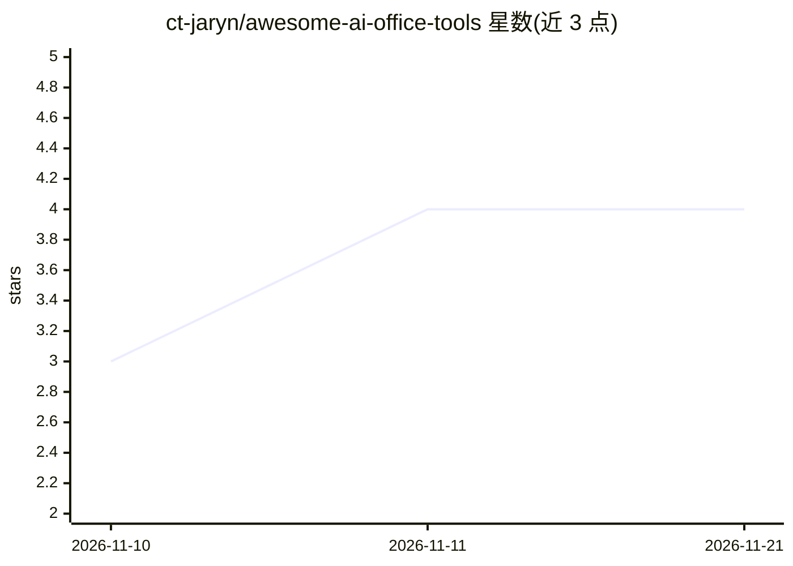

# ct-jaryn/awesome-ai-office-tools

⭐ 4 · Python · CC-BY-4.0 · 推送 2026-11-20 · [GitHub](https://github.com/ct-jaryn/awesome-ai-office-tools) · 个人维护 · 中文 README

**面向中文用户的 AI 办公工具与智能体导航清单**

以单个 Markdown 列表形式维护的导航仓库，按知识工作任务分类收录办公工具：AI 工作台与智能体、写作文档与演示、调研与知识管理、会议协作、工作流自动化五类，每个条目给出场景、主要功能及官网或源码链接。收录同时包含开源与商业产品，描述以公开官方资料为依据，明确声明非软件、未实测、不代表排名。附离线校验脚本（Python 3.9+，仅标准库）检查分类顺序与中英文版本一致性，CI 仅手动触发。

## 筛选速览

| 维度 | 判定 | 备注 |
|---|---|---|
| AI 角色 | `ai-knowledge` | 知识聚合/清单类 |
| 许可风险 | `viral` | CC-BY-4.0 |
| 部署形态 | `None` |  |
| 模型依赖 | — | README 未给出锁定关系 |
| 硬件要求 | — | 无带数字的原话,不猜 |
| 安装摩擦 | `low` | 无编译、无系统依赖或容器化 |
| 成熟度 | — | 结构信号不足 |

## 能力要点

- 按工作任务组织五类办公工具条目，每条含场景、功能与链接
- 提供离线校验脚本核对分类、链接与中英文一致性
- 中英双版本 README 同步维护
- 附隐私与选型指南及常见选型问题

## 适用场景

- 按委派任务、写作、调研、会议、自动化等场景筛选 AI 办公工具
- 寻找类似 WorkBuddy 的 AI 办公智能体候选
- 了解面向中文用户的 AI 办公工具生态收录范围

## 场景标签

`精选清单` · 领域:学习与行业

## 证据(README 行号)

> L11: 本仓库是一份面向中文用户的 AI 办公工具导航，条目按知识工作任务组织：从委派多步骤工作的 AI 工作台与智能体，到文档、调研、会议和工作流自动化工具。条目描述以公开的官方产品或源码资料为依据；收录同时包含开源与商业产品，分类只反
> L43: 本项目是产品导航，不是 AI Agent 软件；收录包含开源和商业产品，不表示已实测、认证或推荐排名。

## 星数曲线

2026-11-10 3 → 2026-11-21 4（+1）

---
*卡片 v1 · prompt 1.4 · 生成 2026-11-21 · 置信度 high · 依据 README sha `9625663accaf` · [字段定义](../../DATASET.md)*
