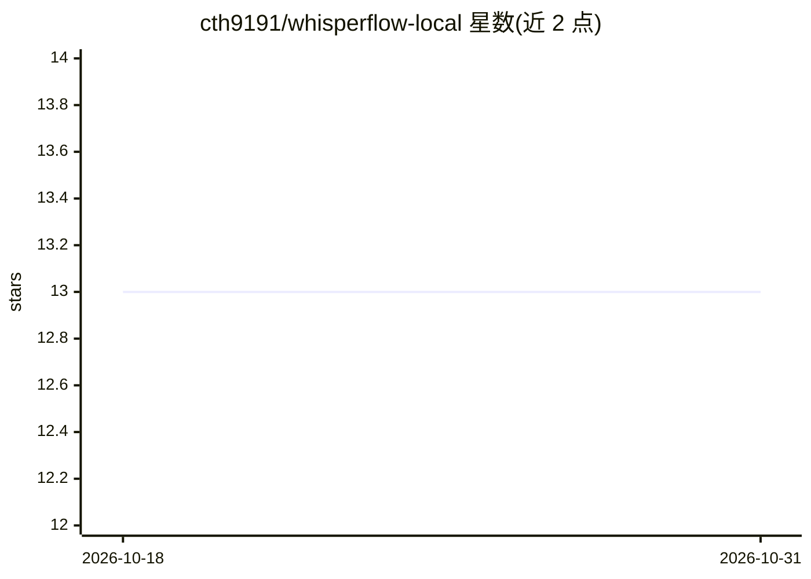

# cth9191/whisperflow-local

⭐ 13 · Python · MIT · 推送 2026-06-30 · [GitHub](https://github.com/cth9191/whisperflow-local) · 个人维护

**Windows 本地语音听写工具：热键说话，AI 修整后贴入焦点输入框**

Windows 全局热key听写工具：Ctrl+Win 切换录音，麦克风采集后用 faster-whisper large-v3-turbo（CUDA）做语音转文字，再经本地 Ollama LLM 清理（去填充词、修语法标点），以不抢焦点的剪贴板粘贴插入当前输入框。提供 PySide6 悬浮胶囊显示音量、托盘退出、开机自启、doctor 环境检查与 selftest。要求 Windows 10/11、NVIDIA GPU（有 CPU 回退但慢）、Python 3.11+ 与 uv。v1 仅限 Windows，打包安装器与流式 STT 等列为 v2 范围。

## 筛选速览

| 维度 | 判定 | 备注 |
|---|---|---|
| AI 角色 | `ai-native` | 本体是模型或模型工具 |
| 许可风险 | `permissive` | MIT |
| 部署形态 | `library` | 以包/库形式分发 |
| 模型依赖 | local-ok | 支持本地模型 |
| 硬件要求 | — | 无带数字的原话,不猜 |
| 安装摩擦 | `medium` | 含编译或系统依赖之一 |
| 成熟度 | `idea` | |

## 能力要点

- faster-whisper large-v3-turbo CUDA 转写 + 本地 Ollama 清理，听写时无云端调用
- 不激活、可点击穿透的 PySide6 音量胶囊与焦点安全粘贴
- doctor 环境健康检查、selftest 端到端自测、自启动安装
- config.yaml 集中配置热键/模型/插入模式，默认仅记录元数据日志

## 适用场景

- 在任意 Windows 应用里用热键语音输入并自动得到修整后的文本
- 不依赖云服务在本机完成语音转写与文本清理
- 通过 doctor/selftest 命令自行排查 CUDA 与 Ollama 环境

## 场景标签

`语音识别` · 领域:感知与多模态

## 证据(README 行号)

> L18: `Ctrl+Win` (toggle) → mic capture (`sounddevice`, 16 kHz mono) → STT
> L19: (`faster-whisper large-v3-turbo`, CUDA) → cleanup (local Ollama LLM) → focus-safe
> L6: focus. STT and the cleanup LLM both run on-device — **no cloud calls at dictation

## 星数曲线

2026-10-18 13 → 2026-10-31 13（+0）

---
*卡片 v1 · prompt 1.4 · 生成 2026-10-31 · 置信度 high · 依据 README sha `7e4e126ece4d` · [字段定义](../../DATASET.md)*
