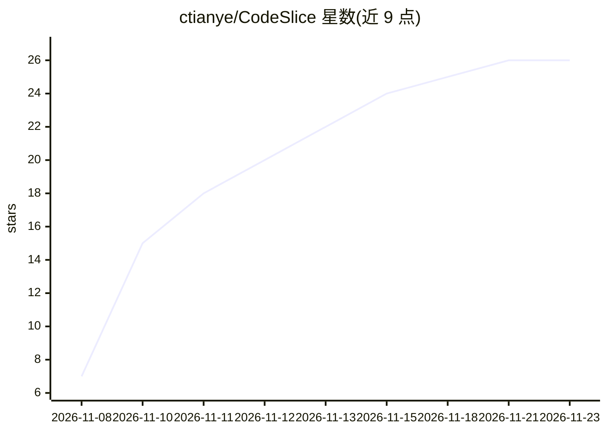

# ctianye/CodeSlice

⭐ 26 · Python · MIT · 推送 2026-11-20 · [GitHub](https://github.com/ctianye/CodeSlice) · [官网](https://github.com/ctianye/CodeSlice/releases/latest) · 个人维护 · 中文 README

**本地优先的 AI 代码阅读桌面应用，回答带可点击源码引用**

面向开发者的 Electron 桌面应用：添加本地代码仓库后，在内置编辑器阅读源码并针对选中代码提问，AI 回答附可点击的文件与行号引用；智能体请求写文件或执行命令时需用户逐次审核批准。还提供 Git 版本只读视图、IDE 式符号跳转（F12/引用列表）、笔记系统（引用回溯到写作时的提交）以及代码/笔记知识图谱（tree-sitter 符号索引、SQLite 持久化布局）。以 MIT 许可分发 Windows/macOS/Linux 安装包，本地后端可配合用户配置的模型（含 Ollama）运行。

## 筛选速览

| 维度 | 判定 | 备注 |
|---|---|---|
| AI 角色 | `ai-native` | 本体是模型或模型工具 |
| 许可风险 | `permissive` | MIT |
| 部署形态 | `desktop` | 安装包/桌面程序 |
| 模型依赖 | local-ok | 支持本地模型 |
| 硬件要求 | — | 无带数字的原话,不猜 |
| 安装摩擦 | `medium` | 含编译或系统依赖之一 |
| 成熟度 | — | 结构信号不足 |

## 能力要点

- 回答附可点击文件与行号引用，直接定位源码
- 写文件/执行命令需人工审核批准后才执行
- IDE 式跳转（F12 定义、Shift+F12 引用、跳转历史）与持久化符号索引
- 代码/笔记双图谱，布局持久化到 SQLite，笔记引用回溯到写作时的提交

## 适用场景

- 阅读陌生代码库时选中代码直接提问并核对引用出处
- 在只读的 Git 历史版本中浏览代码、图谱与笔记
- 把代码解释保存为可搜索、可回溯源码版本的笔记

## 场景标签

`RAG` `知识库管理` · 领域:知识与检索

## 证据(README 行号)

> L5: CodeSlice 是一款本地优先的 AI 代码阅读桌面应用。添加代码仓库后，打开文件、选中代码并开始提问。回答附有可点击的文件与行号引用；AI 需要写文件或运行命令时，先由你审核授权。
> L29: **CodeSlice** is a local-first AI code-reading desktop app for developers. Drop
> L31: start a conversation. Answers include clickable file-and-line citations; changes

## 星数曲线

2026-11-08 7 → 2026-11-23 26（+19）

---
*卡片 v1 · prompt 1.4 · 生成 2026-11-18 · 置信度 mid · 依据 README sha `7250c5c95323` · [字段定义](../../DATASET.md)*
