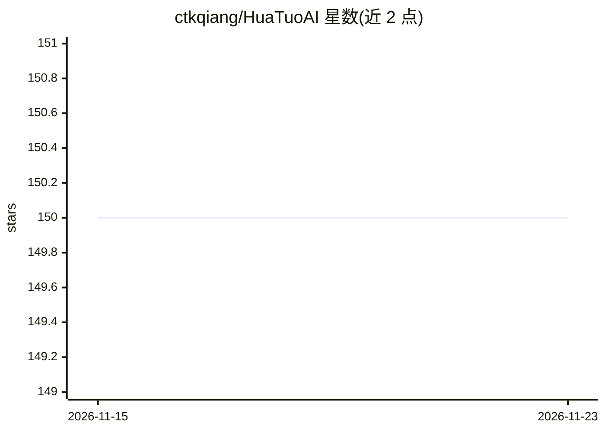

# ctkqiang/HuaTuoAI

⭐ 150 · Python · NOASSERTION · 推送 2026-11-15 · [GitHub](https://github.com/ctkqiang/HuaTuoAI) · 个人维护 · 中文 README

**输入图像识别分类中草药的 CNN 图像分类系统**

基于 Python 3.10 与 TensorFlow 构建的中草药图像分类系统：通过卷积层、池化层与全连接层提取特征，经 softmax 输出类别，损失函数为二元交叉熵，优化器为 RMSProp。提供预处理与数据增强、模型评估脚本（准确率/精确率/召回率/F1）及部署指南；用户将训练数据放入 data/images、验证输入放入 data/input，通过 pip 安装依赖后运行 run.py，并附带 chinese_medicine.h5 模型演示。README 中展示的训练记录显示准确率为 0。

## 筛选速览

| 维度 | 判定 | 备注 |
|---|---|---|
| AI 角色 | `ai-native` | 本体是模型或模型工具 |
| 许可风险 | `none` | NOASSERTION |
| 部署形态 | `library` | 以包/库形式分发 |
| 模型依赖 | — | README 未给出锁定关系 |
| 硬件要求 | — | 无带数字的原话,不猜 |
| 安装摩擦 | `low` | 无编译、无系统依赖或容器化 |
| 成熟度 | — | 结构信号不足 |

## 能力要点

- CNN 模型对中草药与成分做图像分类（softmax 输出类别）
- 提供数据增强、评估脚本（准确率/精确率/召回率/F1）与部署指南
- 以 chinese_medicine.h5 模型文件提供推理演示

## 适用场景

- 上传中草药图像获得分类结果
- 扩充自有数据集训练中药分类模型
- 将训练好的模型集成到生产环境做实时推理

## 场景标签

`目标检测` · 领域:感知与多模态

## 证据(README 行号)

> L22: - **图像分类**：该项目的核心功能是图像分类模型，利用深度学习技术对中草药和成分进行分类。模型使用了一种称为卷积神经网络（Convolutional Neural Network，CNN） 的算法。具体而言，模型通过一系列卷积
> L84: python3 run.py

## 星数曲线

2026-11-15 150 → 2026-11-23 150（+0）

---
*卡片 v1 · prompt 1.4 · 生成 2026-11-17 · 置信度 high · 依据 README sha `f7d6968acad3` · [字段定义](../../DATASET.md)*
