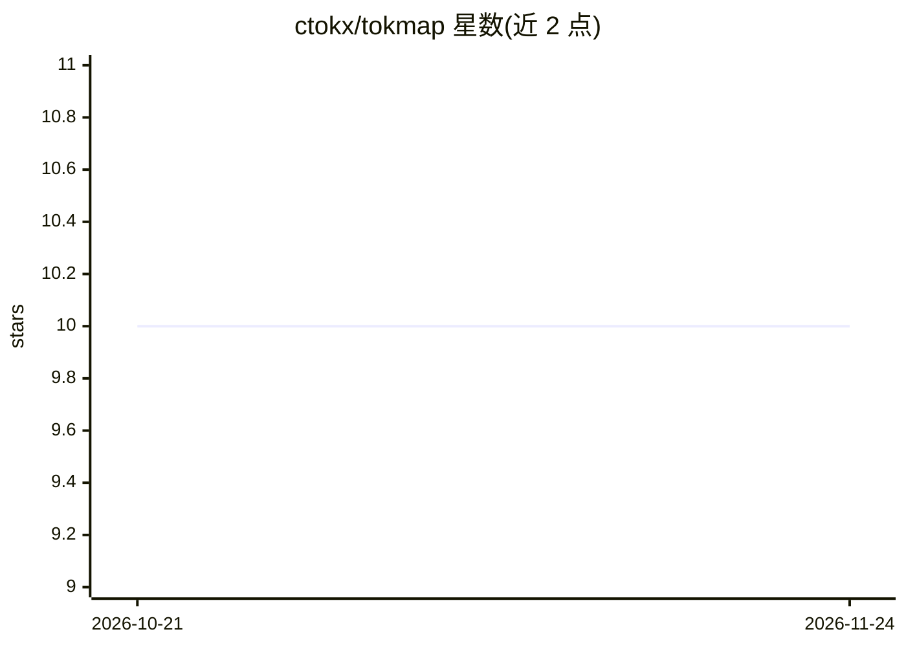

# ctokx/tokmap

⭐ 10 · Rust · MIT · 推送 2026-11-07 · [GitHub](https://github.com/ctokx/tokmap) · 个人维护

**Rust 异步网络扫描器：读取 nmap 签名库识别服务与操作系统**

tokmap 是 Rust 编写的异步网络扫描器，运行时读取 nmap 公开签名数据库（服务探测、端口频率、OS 指纹、MAC 前缀、RPC、协议）执行端口扫描、服务识别与 OS 指纹。支持 8 种 TCP/UDP 扫描类型，输出 nmap 风格表格或 JSON/XML。可选集成 Gemini 对 banner 做 LLM 分析。项目自述为早期阶段：检测为被动匹配、OS 指纹仅用 TTL/窗口启发式、仅支持 IPv4、未经生产审计。

## 筛选速览

| 维度 | 判定 | 备注 |
|---|---|---|
| AI 角色 | `ai-enhanced` | 去掉 AI 部分产品仍成立 |
| 许可风险 | `permissive` | MIT |
| 部署形态 | `None` |  |
| 模型依赖 | — | README 未给出锁定关系 |
| 硬件要求 | — | 无带数字的原话,不猜 |
| 安装摩擦 | `medium` | 含编译或系统依赖之一 |
| 成熟度 | `idea` | |

## 能力要点

- 运行时读取 6 类 nmap 数据文件，缺失时降级运行
- 8 种扫描类型，部分需管理员/root 权限，TCP connect 无需特权
- 支持 JSON/XML/grepable 多种输出格式
- 可选 Gemini LLM banner 分析（需 API key）

## 适用场景

- 扫描自有或授权网络识别开放端口与服务
- 通过 banner 匹配判断目标操作系统
- 将扫描结果导出 JSON 供后续处理

## 场景标签

`网络安全` · 领域:学习与行业

## 证据(README 行号)

> L3: An asynchronous network scanner written in Rust. Uses nmap's public signature databases for service detection, OS fi
> L5: **Status: work in progress.** See Limitations below.
> L72: - **Service detection is passive only.** Tokmap matches banners against the nmap signature database but does not ac

## 星数曲线

2026-10-21 10 → 2026-11-24 10（+0）

---
*卡片 v1 · prompt 1.4 · 生成 2026-11-20 · 置信度 high · 依据 README sha `00471257faaa` · [字段定义](../../DATASET.md)*
