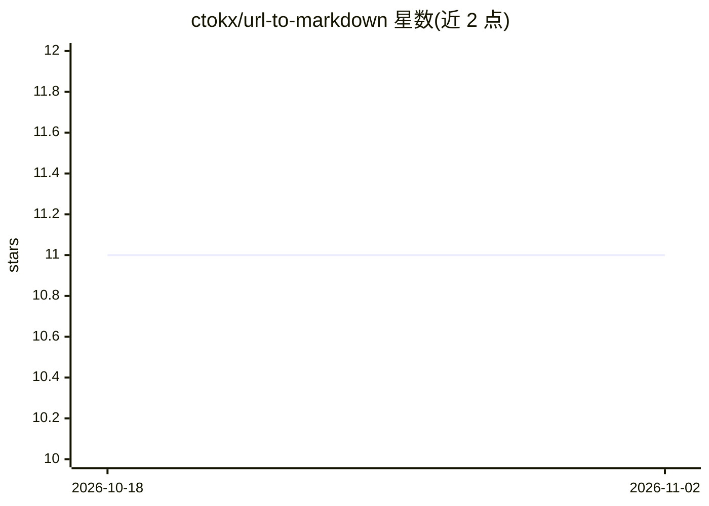

# ctokx/url-to-markdown

⭐ 11 · JavaScript · MIT · 推送 2026-03-08 · [GitHub](https://github.com/ctokx/url-to-markdown) · [官网](https://ctokx.github.io/url-to-markdown/) · 个人维护

**网页转 Markdown 工具，面向 RAG/LLM 数据准备**

由 Web 应用（浏览器打开 index.html）与 Node.js CLI（md4llm）两部分组成：用 Turndown + GFM 将网页 HTML 转为 Markdown，支持 CSS 选择器定向提取、常见页面噪音清理（广告/导航/cookie 横幅/隐藏元素）、媒体与链接剥离、表格对齐、代码块语言检测，以及标题/OG/Twitter/JSON-LD 等元数据抽取；CLI 可批量处理，可选 --render-js 借助 Playwright 渲染 JS 页面。不做分块、嵌入、检索或向量索引。

## 筛选速览

| 维度 | 判定 | 备注 |
|---|---|---|
| AI 角色 | `ai-enhanced` | 去掉 AI 部分产品仍成立 |
| 许可风险 | `permissive` | MIT |
| 部署形态 | `library` | 以包/库形式分发 |
| 模型依赖 | — | README 未给出锁定关系 |
| 硬件要求 | — | 无带数字的原话,不猜 |
| 安装摩擦 | `low` | 无编译、无系统依赖或容器化 |
| 成熟度 | `idea` | |

## 能力要点

- Turndown + GFM 的 HTML→Markdown 转换，支持 CSS 选择器定向提取
- 广告/导航/cookie 横幅等噪音清理与 boilerplate 去重
- 元数据抽取（title/canonical/Open Graph/Twitter/JSON-LD）
- CLI 批量处理与可选 Playwright JS 渲染（--render-js）

## 适用场景

- 把文档/博客/论坛页面转为 Markdown 供 RAG 管线摄取
- 批量抓取并清洗网页内容生成 LLM 友好文本
- 提取页面元数据随 Markdown 一并输出为 JSON

## 场景标签

`网页抓取` `文档解析` · 领域:效率与自动化

## 证据(README 行号)

> L3: Convert webpage HTML into Markdown that is easier to use in RAG/LLM pipelines.
> L27: - This project does not do chunking, embedding, retrieval, or vector indexing.
> L93: Typical flow:

## 星数曲线

2026-10-18 11 → 2026-11-02 11（+0）

---
*卡片 v1 · prompt 1.4 · 生成 2026-11-02 · 置信度 high · 依据 README sha `1baed1dd7180` · [字段定义](../../DATASET.md)*
