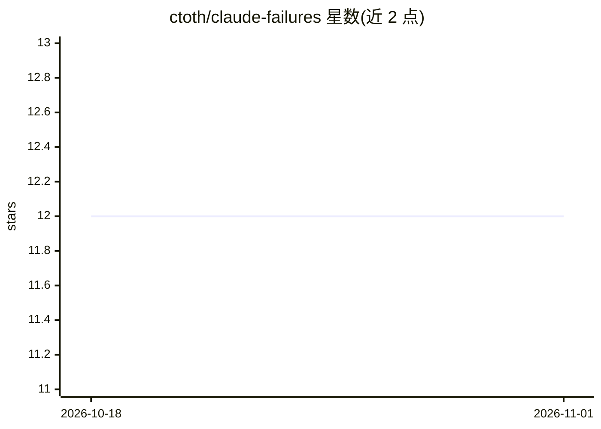

# ctoth/claude-failures

⭐ 12 · 推送 2026-04-06 · [GitHub](https://github.com/ctoth/claude-failures) · 个人维护

**Claude Code 真实失误案例的事后分析文集**

记录与 Claude Code（Anthropic 的 AI 编码代理）协作中出现失误的仓库：每个文件是一篇真实事件的事后分析，说明发生了什么、本应如何做、根因及可预防的规则。README 归纳常见失误模式：凭假设代替观察、把提问当作改指令、隐藏而非修复 bug、恐慌性回滚、不读依赖即宣布完成、从不提交、完成冲动压倒理解。文件按 YYYY-MM-DD-描述.md 命名，面向关注 AI 代理行为与可靠性的人群。无安装与运行流程，为纯文档集合。

## 筛选速览

| 维度 | 判定 | 备注 |
|---|---|---|
| AI 角色 | `ai-knowledge` | 知识聚合/清单类 |
| 许可风险 | `none` | — |
| 部署形态 | `None` |  |
| 模型依赖 | — | README 未给出锁定关系 |
| 硬件要求 | — | 无带数字的原话,不猜 |
| 安装摩擦 | `low` | 无编译、无系统依赖或容器化 |
| 成熟度 | — | 结构信号不足 |

## 能力要点

- 真实事件的事后分析，每篇含事件经过/应然做法/根因/预防规则
- 归纳 7 类重复出现的代理失误模式
- 文件按日期加短描述命名，格式统一

## 适用场景

- 了解 AI 编码代理的典型失误模式以制定协作规则
- 为团队制定代理使用规范提供案例参考
- 研究 LLM 代理行为时查找真实失败案例

## 场景标签

 · 领域:AI 工程/知识记录

## 证据(README 行号)

> L3: Documented failure modes from working with Claude Code (Anthropic's AI coding agent). Each file is a post-mortem of 
> L7: AI coding agents fail in predictable, repeated patterns. Documenting these failures concretely — with what happened,

## 星数曲线

2026-10-18 12 → 2026-11-01 12（+0）

---
*卡片 v1 · prompt 1.4 · 生成 2026-11-01 · 置信度 high · 依据 README sha `770fe0d9b552` · [字段定义](../../DATASET.md)*
