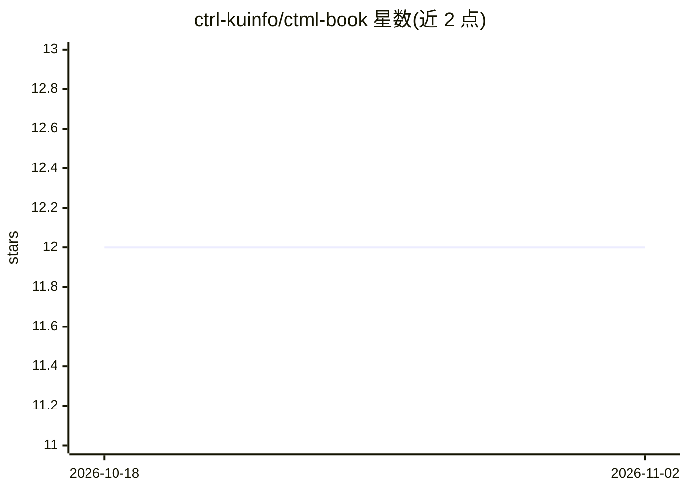

# ctrl-kuinfo/ctml-book

⭐ 12 · JavaScript · MIT · 推送 2026-08-04 · [GitHub](https://github.com/ctrl-kuinfo/ctml-book) · [官网](https://amzn.to/3Vzt5EB) · 组织维护

**系统控制理论与统计机器学习书籍的官方支持资料页**

书籍《システム制御理論と統計的機械学習》（加嶋健司著，森北出版，2025年，ISBN 978-4-627-61481-9）的支持页面仓库，提供书籍信息与引用格式、正误表与出版社页面链接、书中数值计算所用简易代码（浏览器可运行的 JavaScript 版本、MATLAB .m 文件一式、可单独运行的 Python .py 文件一式），以及各章概要的自学/研讨会用幻灯片。代码以可视化理解为目的，未做性能优化。

## 筛选速览

| 维度 | 判定 | 备注 |
|---|---|---|
| AI 角色 | `ai-knowledge` | 知识聚合/清单类 |
| 许可风险 | `permissive` | MIT |
| 部署形态 | `None` |  |
| 模型依赖 | — | README 未给出锁定关系 |
| 硬件要求 | — | 无带数字的原话,不猜 |
| 安装摩擦 | `low` | 无编译、无系统依赖或容器化 |
| 成熟度 | — | 结构信号不足 |

## 能力要点

- 书籍数值计算的 JavaScript/MATLAB/Python 三种实现
- JavaScript 版本可在浏览器中直接运行并确认结果
- 各章概要幻灯片（自学路线图与研讨会资料）
- 正误表、补足信息与 LaTeX beamer 源文件申请渠道

## 适用场景

- 学习本书时对照运行书中数值计算代码
- 查找本书的正误表与出版社补充信息
- 自学或讲义使用各章概要幻灯片

## 场景标签

`教程课程` · 领域:学习与行业

## 证据(README 行号)

> L1: ## 書籍情報
> L3: - 著者　加嶋 健司

## 星数曲线

2026-10-18 12 → 2026-11-02 12（+0）

---
*卡片 v1 · prompt 1.4 · 生成 2026-11-01 · 置信度 high · 依据 README sha `7fc679d9eb02` · [字段定义](../../DATASET.md)*
