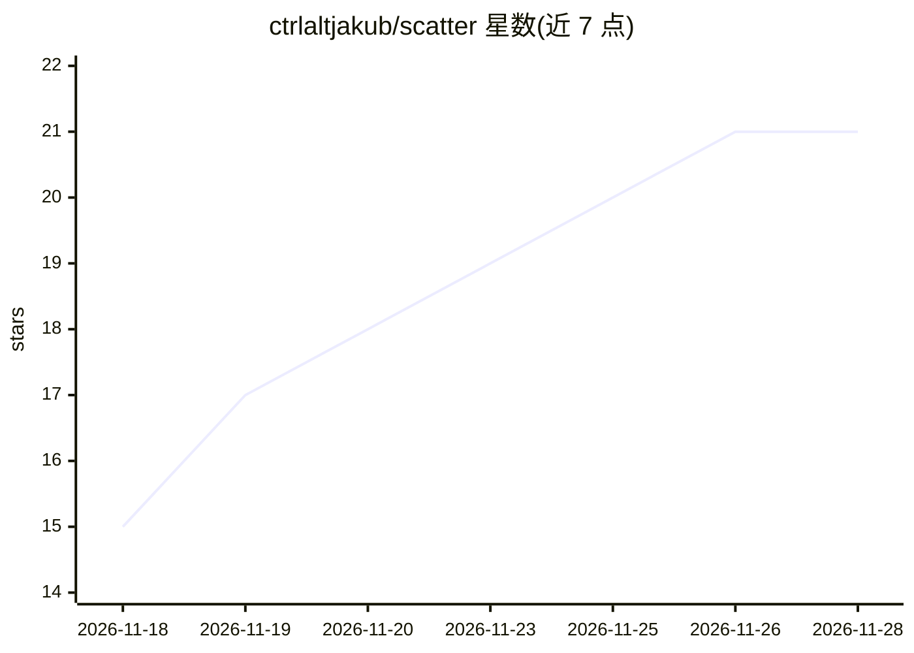

# ctrlaltjakub/scatter

⭐ 21 · TypeScript · NOASSERTION · 推送 2026-11-22 · [GitHub](https://github.com/ctrlaltjakub/scatter) · [官网](https://scatter.study) · 个人维护

**自带 API key 的 AI 思维导图知识探索 Web 应用**

在无限画布上用 AI 生成主题结构化概览的思维导图工具：悬停查看术语解释、点击创建连接节点，支持上传图片/视频、针对选中图像区域提问、生成可在画布运行的交互节点，并可基于自有文档/网页等来源回答并附引用。采用 BYOK 模式，可接入 OpenRouter、OpenAI、Anthropic 或 Ollama/LM Studio 等本地服务；项目数据存储在浏览器本地，同步为可选（Google Drive/WebDAV）。以 source-available 形式免费提供，本地运行需 Node.js 22/24 与支持 WebGL2 的桌面浏览器。

## 筛选速览

| 维度 | 判定 | 备注 |
|---|---|---|
| AI 角色 | `ai-native` | 本体是模型或模型工具 |
| 许可风险 | `none` | NOASSERTION |
| 部署形态 | `library` | 以包/库形式分发 |
| 模型依赖 | local-ok | 支持本地模型 |
| 硬件要求 | — | 无带数字的原话,不猜 |
| 安装摩擦 | `low` | 无编译、无系统依赖或容器化 |
| 成熟度 | — | 结构信号不足 |

## 能力要点

- 主题→结构化概览→标记术语→连接节点的思维导图探索流
- BYOK：接入 OpenRouter/OpenAI/Anthropic 或 Ollama/LM Studio 本地服务
- 项目与 API key 默认存储在浏览器本地，请求直连模型提供商
- 主/副/交互/图像模型分工以控制 token 成本

## 适用场景

- 学习新主题时生成结构化概览并逐层深入探索
- 基于自己的 PDF/文档/网页资料做带引用的问答
- 在画布上向 AI 提问并运行生成的交互内容

## 场景标签

`知识库管理` `文档问答` · 领域:知识与检索

## 证据(README 行号)

> L5:  Explore any topic with AI-powered mind maps .
> L9: **Free** and **source-available**. Bring **your own API keys** for **cloud** or **local models**. Projects **stay in
> L85: |**Model providers**|OpenRouter, OpenAI, Anthropic, or a local server such as Ollama|

## 星数曲线

2026-11-18 15 → 2026-11-28 21（+6）

---
*卡片 v1 · prompt 1.4 · 生成 2026-11-18 · 置信度 high · 依据 README sha `cf3395e00836` · [字段定义](../../DATASET.md)*
