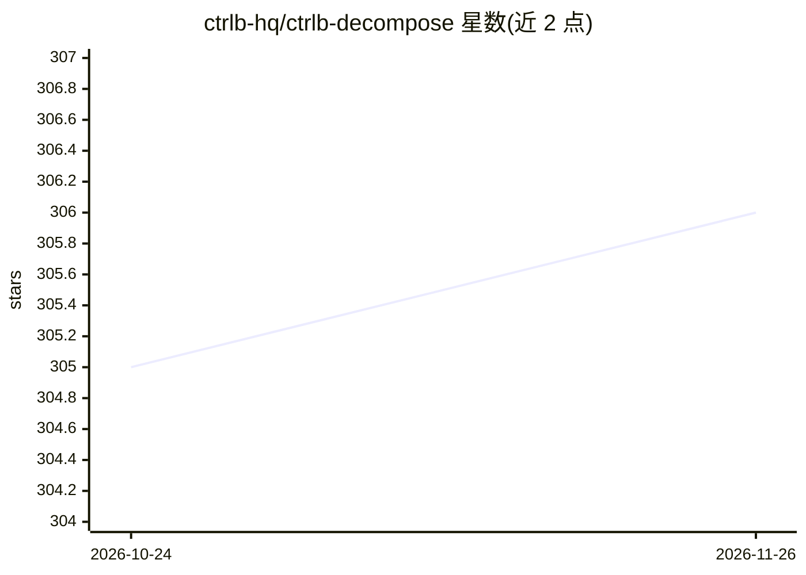

# ctrlb-hq/ctrlb-decompose

⭐ 306 · Rust · MIT · 推送 2026-11-14 · [GitHub](https://github.com/ctrlb-hq/ctrlb-decompose) · [官网](https://ctrlb.ai/decompose) · 组织维护

**把海量日志压缩为 LLM 可用模式的日志分析 CLI**

ctrlb-decompose 将数百万行嘈杂日志归约为带类型变量、分位数与异常信息的紧凑模式，输出面向终端调查、LLM 提示（token 紧凑 markdown）与程序化消费（JSON）三种格式。内部采用两阶段流式管线：CLP 编码将变量规整为类型化占位符，Drain3 前缀树聚类生成 logtype，并提取 IPv4/UUID/时长等语义类型；以 DDSketch/HyperLogLog++/蓄水池采样实现有界内存。以 CLI、浏览器 WASM 与 Rust 库形式运行，数据处理在本地完成。

## 筛选速览

| 维度 | 判定 | 备注 |
|---|---|---|
| AI 角色 | `ai-enhanced` | 去掉 AI 部分产品仍成立 |
| 许可风险 | `permissive` | MIT |
| 部署形态 | `desktop` | 安装包/桌面程序 |
| 模型依赖 | — | README 未给出锁定关系 |
| 硬件要求 | — | 无带数字的原话,不猜 |
| 安装摩擦 | `low` | 无编译、无系统依赖或容器化 |
| 成熟度 | — | 结构信号不足 |

## 能力要点

- 两阶段管线：CLP 编码 + Drain3 聚类，单遍流式处理
- 三种输出模式：--human / --llm / --json
- 浏览器 WASM 演示可运行完整管线，无需安装
- 提供 Claude Code 插件，通过自然语言分析日志

## 适用场景

- 把重复日志压缩成少量模式供 LLM 分析
- 终端里快速调查错误日志中的高频模式与异常
- 以 JSON 输出接入程序化监控流程

## 场景标签

`数据分析` · 领域:效率与自动化

## 证据(README 行号)

> L3: **Turn millions of noisy log lines into compact patterns with typed variables, quantiles, anomalies, and LLM-ready o
> L201: |**LLM**|`--llm`|Feeding into LLMs — compact, token-efficient markdown|
> L226: ## Claude Code Plugin

## 星数曲线

2026-10-24 305 → 2026-11-26 306（+1）

---
*卡片 v1 · prompt 1.4 · 生成 2026-11-25 · 置信度 high · 依据 README sha `0af7e229576e` · [字段定义](../../DATASET.md)*
