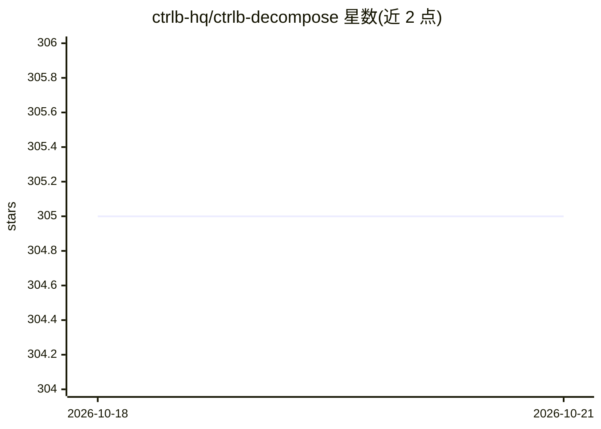

# ctrlb-hq/ctrlb-decompose

⭐ 305 · Rust · MIT · 推送 2026-09-21 · [GitHub](https://github.com/ctrlb-hq/ctrlb-decompose) · [官网](https://ctrlb.ai/decompose) · 组织维护

**把海量日志压缩成带类型变量与统计的模式，产出 LLM 友好输出**

日志模式归约 CLI 工具，两阶段管线：CLP 编码将变量 token 归一化为类型化占位符，Drain3 增量聚类生成模板；变量分类为 IPv4/UUID/Duration 等 9 种语义类型，并以 DDSketch、HyperLogLog++、蓄水池采样控制内存。提供 Human/LLM/JSON 三种输出模式，LLM 模式生成可直接贴入提示词的紧凑 markdown。可经 CLI、浏览器 WASM 或 Rust 库运行，日志不离开本地。另提供 Claude Code 插件用自然语言分析日志。面向需要处理大规模日志并交给 LLM 或程序消费的开发者。

## 筛选速览

| 维度 | 判定 | 备注 |
|---|---|---|
| AI 角色 | `ai-enhanced` | 去掉 AI 部分产品仍成立 |
| 许可风险 | `permissive` | MIT |
| 部署形态 | `desktop` | 安装包/桌面程序 |
| 模型依赖 | — | README 未给出锁定关系 |
| 硬件要求 | — | 无带数字的原话,不猜 |
| 安装摩擦 | `low` | 无编译、无系统依赖或容器化 |
| 成熟度 | — | 结构信号不足 |

## 能力要点

- CLP 编码 + Drain3 增量聚类的单遍流式日志归约
- 9 种语义类型变量分类（IPv4/UUID/Duration/Enum 等）
- Human/LLM/JSON 三种输出模式，LLM 模式面向 token 节省
- Claude Code 插件可用自然语言触发日志分析

## 适用场景

- 把数万行日志压成少量模式供终端排查
- 压缩日志后贴入 LLM 提示词做错误与异常分析
- 以 JSON 输出接入程序化日志分析流程

## 场景标签

 · 领域:日志/可观测性工具

## 证据(README 行号)

> L3: **Turn millions of noisy log lines into compact patterns with typed variables, quantiles, anomalies, and LLM-ready o
> L49: **`LLM OPTIMIZE` mode** — compact markdown for feeding into an LLM:
> L225: ## Claude Code Plugin

## 星数曲线

2026-10-18 305 → 2026-10-21 305（+0）

---
*卡片 v1 · prompt 1.4 · 生成 2026-10-22 · 置信度 high · 依据 README sha `dddf679d1909` · [字段定义](../../DATASET.md)*
