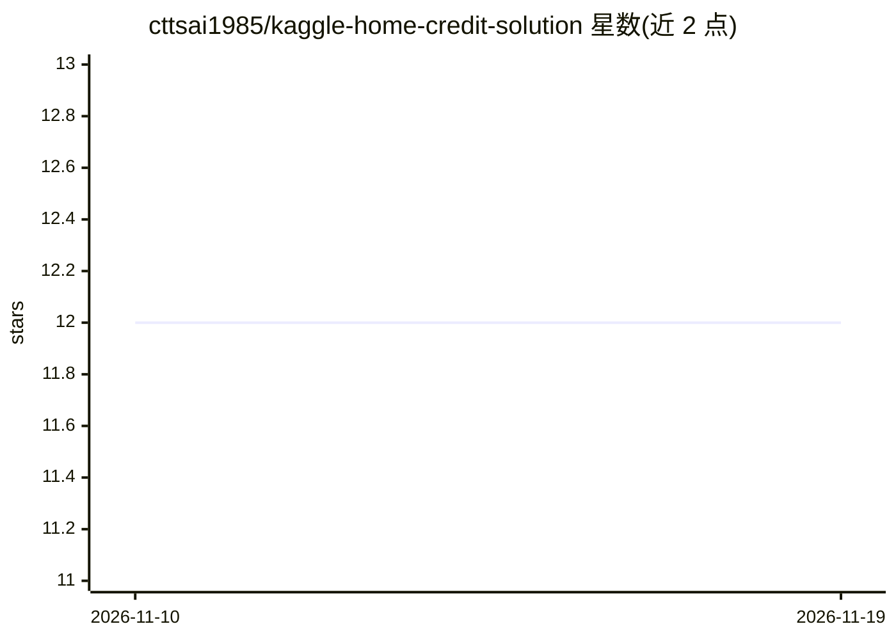

# cttsai1985/kaggle-home-credit-solution

⭐ 12 · Jupyter Notebook · Apache-2.0 · 推送 2026-11-09 · [GitHub](https://github.com/cttsai1985/kaggle-home-credit-solution) · 个人维护

**面向贷款方场景的 Kaggle 信用违约风险预测复现方案**

针对 Kaggle Home Credit 违约风险竞赛的完整可复现解决方案：将申请表与征信局、历史申请、还款行为等多张关系表按申请人聚合为单行特征，训练五折分层 LightGBM 集成并输出 XGBoost 堆叠与 blend 提交。提供 uv 锁定依赖的复现流程、Docker 化 JupyterLab 与实验跟踪（MLflow 记录指纹与校验和）、`home-credit analyze` 折间诊断命令，以及保存模型的打包与 HTTP 服务校验指南。适合数据科学参赛者与信贷风控建模研究者复现或扩展。

## 筛选速览

| 维度 | 判定 | 备注 |
|---|---|---|
| AI 角色 | `ai-native` | 本体是模型或模型工具 |
| 许可风险 | `permissive` | Apache-2.0 |
| 部署形态 | `self-host` | docker 或自建部署 |
| 模型依赖 | — | README 未给出锁定关系 |
| 硬件要求 | — | 无带数字的原话,不猜 |
| 安装摩擦 | `low` | 无编译、无系统依赖或容器化 |
| 成熟度 | — | 结构信号不足 |

## 能力要点

- 关系表按申请人聚合为单行特征并做 join 粒度校验
- 五固定种子分层折交叉验证，OOF AUC 0.79257
- MLflow 实验跟踪记录配置/数据/源码指纹与工件校验和
- 保存模型的导出与原生-HTTP 一致性校验流程

## 适用场景

- 复现该竞赛的历史 blend 提交分数
- 学习多表征信数据的特征工程与聚合方法
- 搭建带指纹与校验和的可复现训练流水线
- 在 Kaggle 托管笔记本上运行相同的训练包

## 场景标签

`MLOps` `金融量化` · 领域:学习与行业

## 证据(README 行号)

> L3: Assessing repayment risk is especially difficult when an application has a limited credit history. Home Credit's cha
> L41: Five fixed-seed stratified folds produce one held-out prediction per training applicant while preserving the target

## 星数曲线

2026-11-10 12 → 2026-11-19 12（+0）

---
*卡片 v1 · prompt 1.4 · 生成 2026-11-18 · 置信度 high · 依据 README sha `ba0c1109a9c0` · [字段定义](../../DATASET.md)*
