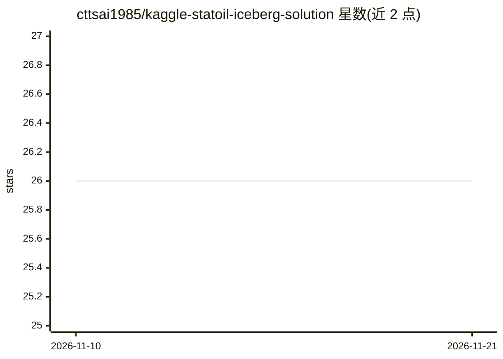

# cttsai1985/kaggle-statoil-iceberg-solution

⭐ 26 · Jupyter Notebook · MIT · 推送 2026-11-10 · [GitHub](https://github.com/cttsai1985/kaggle-statoil-iceberg-solution) · 个人维护

**Kaggle Statoil 冰山/船只雷达图像分类解法与复现工程**

面向 Kaggle Statoil/C-CORE 竞赛的完整解法：用双极化（HH/HV）75×75 雷达图像与可选入射角元数据，训练紧凑 PyTorch CNN 输出冰山概率。提供分组五折、双种子验证协议，保留历史 2017 单模型成绩（public 0.19348）作为基准，并分析元数据分支收益主要来自测试集中不存在的缺失角度样本。工程上以 Python 包 + CLI + Docker JupyterLab + Kaggle notebook 四种方式运行同一实现，记录配置、指标与校验和，支持 MLflow 导入与批处理故障恢复。需要竞赛授权数据，权重与数据不入库。

## 筛选速览

| 维度 | 判定 | 备注 |
|---|---|---|
| AI 角色 | `ai-native` | 本体是模型或模型工具 |
| 许可风险 | `permissive` | MIT |
| 部署形态 | `self-host` | docker 或自建部署 |
| 模型依赖 | — | README 未给出锁定关系 |
| 硬件要求 | — | 无带数字的原话,不猜 |
| 安装摩擦 | `low` | 无编译、无系统依赖或容器化 |
| 成熟度 | — | 结构信号不足 |

## 能力要点

- 四翻转变换平均降低 known-angle OOF log loss
- 分组五折、双种子验证，保留全部 1,604 条 OOF 记录与分层诊断
- CLI、Docker JupyterLab、Kaggle notebook 使用同一包实现
- 实验保存配置/指标/校验和，可选 MLflow 导入，批处理可断点恢复

## 适用场景

- 复现 Kaggle 冰山/船只分类竞赛结果
- 参考分组验证与元数据分支的诊断方法
- 在 Docker 或 Kaggle 环境中训练并生成 8,424 条测试预测

## 场景标签

`MLOps` · 领域:训练与推理

## 证据(README 行号)

> L3: Remote marine operations need timely information about possible ice hazards. The Statoil/C-CORE challenge focuses on
> L73: Each observation contains two **75 × 75** radar bands, HH and HV polarization, and an incidence angle. The target i

## 星数曲线

2026-11-10 26 → 2026-11-21 26（+0）

---
*卡片 v1 · prompt 1.4 · 生成 2026-11-18 · 置信度 high · 依据 README sha `a6f7513598a5` · [字段定义](../../DATASET.md)*
