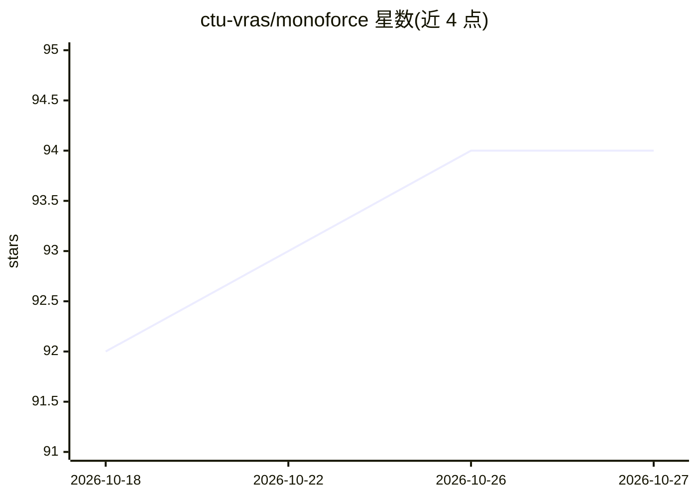

# ctu-vras/monoforce

⭐ 94 · Jupyter Notebook · BSD-3-Clause · 推送 2026-04-11 · [GitHub](https://github.com/ctu-vras/monoforce) · 组织维护

**从 RGB 图像学习机器人-地形交互的可微物理引擎（科研代码）**

MonoForce 是 IROS 2024 论文的配套研究代码：由 Terrain Encoder 与可微 Physics Engine 组成流水线，输入 RGB 图像与相机标定，预测地形属性（高程、摩擦、刚度、阻尼），并据此仿真给定控制序列下的机器人轨迹与交互力。支持下载预训练权重测试、在 ROUGH 数据集上运行示例、训练模型，并提供 ROS 节点与 launch 文件用于集成。README 顶部注明有更新版本已迁移至 ctu-vras/fusionforce 仓库。模型以 PyTorch 实现，附训练与轨迹预测 notebook。

## 筛选速览

| 维度 | 判定 | 备注 |
|---|---|---|
| AI 角色 | `ai-native` | 本体是模型或模型工具 |
| 许可风险 | `permissive` | BSD-3-Clause |
| 部署形态 | `None` |  |
| 模型依赖 | — | README 未给出锁定关系 |
| 硬件要求 | — | 无带数字的原话,不猜 |
| 安装摩擦 | `low` | 无编译、无系统依赖或容器化 |
| 成熟度 | — | 结构信号不足 |

## 能力要点

- Terrain Encoder 从 RGB 图像预测高程/摩擦/刚度/阻尼四种地形属性
- 可微 Physics Engine 仿真轨迹与机器人-地形交互力
- 提供 ROS 节点与 monoforce.launch 集成
- 导航流水线：地形预测→轨迹仿真→按交互力代价选轨迹→控制

## 适用场景

- 机器人越野/植被地形通过性估计与轨迹预测研究
- 基于 RGB 图像的地形属性（摩擦/刚度）预测实验复现
- 将地形交互预测接入 ROS 机器人导航与路径规划

## 场景标签

`科研工具` · 领域:学习与行业

## 证据(README 行号)

> L16: Robot-terrain interaction prediction from RGB camera images as input:
> L34: The MonoForce pipeline consists of the Terrain Encoder and the Physics Engine.
> L103: - **Pytorch**: The model is implemented in Pytorch. Please refer to the

## 星数曲线

2026-10-18 92 → 2026-10-27 94（+2）

---
*卡片 v1 · prompt 1.4 · 生成 2026-10-24 · 置信度 high · 依据 README sha `aa9fd5fe3eb8` · [字段定义](../../DATASET.md)*
