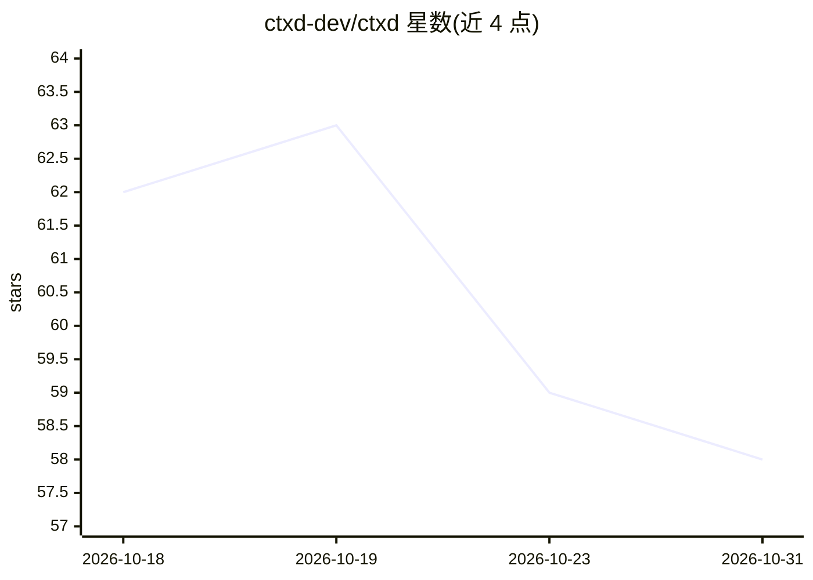

# ctxd-dev/ctxd

⭐ 58 · Python · MIT · 推送 2026-10-28 · [GitHub](https://github.com/ctxd-dev/ctxd) · [官网](https://ctxd.dev) · 组织维护

**为 AI agent 提供本地文件上下文的基础设施**

ctxd 是面向 AI agent 的本地上下文基础设施：追踪用户在计算机上选定的文件夹，并通过 ctxfs 将其以面向路径、agent 可读的上下文形式暴露，供 agent 通过 API、CLI 或 MCP 访问。项目提供概述、快速开始、本地追踪器、ctxfs、CLI、本地 API 与安全等文档页面。README 本身不包含安装或参考说明，指向 docs/public 作为文档唯一来源。

## 筛选速览

| 维度 | 判定 | 备注 |
|---|---|---|
| AI 角色 | `ai-ecosystem` | LLM/agent 周边工具 |
| 许可风险 | `permissive` | MIT |
| 部署形态 | `None` |  |
| 模型依赖 | — | README 未给出锁定关系 |
| 硬件要求 | — | 无带数字的原话,不猜 |
| 安装摩擦 | `low` | 无编译、无系统依赖或容器化 |
| 成熟度 | — | 结构信号不足 |

## 能力要点

- 追踪本地选定文件夹并暴露为 agent 可读上下文
- 通过 API、CLI 与 MCP（Model Context Protocol）提供服务
- ctxfs 提供面向路径的上下文文件系统

## 适用场景

- 让 AI agent 读取和检索本地或云端文件数据
- 通过 MCP 将本地文件接入 agent 工作流

## 场景标签

 · 领域:AI 基础设施/上下文检索

## 证据(README 行号)

> L5: Local context infrastructure for AI agents.
> L9: ctxd tracks folders selected on your computer and exposes them through ctxfs as

## 星数曲线

2026-10-18 62 → 2026-10-31 58（-4）

---
*卡片 v1 · prompt 1.4 · 生成 2026-10-24 · 置信度 low · 依据 README sha `443d03cb5ce0` · [字段定义](../../DATASET.md)*
