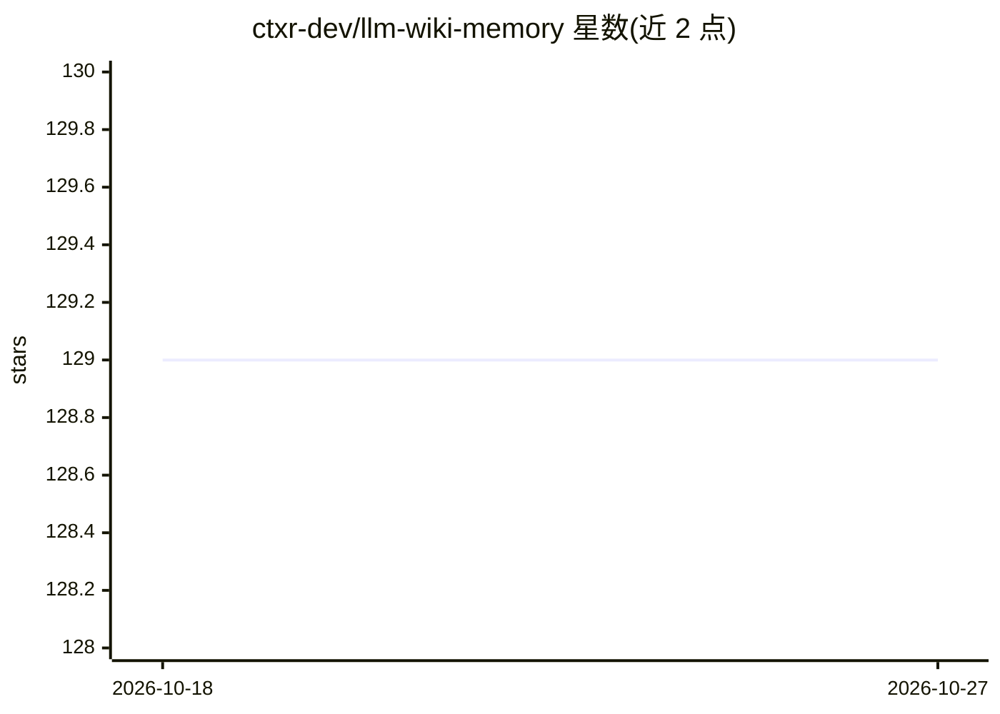

# ctxr-dev/llm-wiki-memory

⭐ 129 · JavaScript · MIT · 推送 2026-09-09 · [GitHub](https://github.com/ctxr-dev/llm-wiki-memory) · 组织维护

**给 AI 编程 agent 的本地 git 版本化记忆层（MCP）**

面向 Claude Code、Cursor、Codex 等 MCP 客户端的持久记忆工具：通过本地 MCP server 捕获会话对话，蒸馏为按日期的 daily 笔记并提炼为知识、经验教训与计划文件；记忆以纯 Markdown 叶子形式存于本地 .llm-wiki-memory/ 目录、由 git 版本化，检索用本地 ONNX transformer 嵌入（默认 embeddinggemma-300m，约 219MB 首次下载后离线运行），无向量数据库、无 Docker、无云服务。LLM 提供方在 .env 配置，可选 anthropic/openai/openai-compatible（含 ollama、vLLM 等）。钩子式自动捕获仅限 Claude Code，其他客户端走 MCP 工具；自我改进教训需逐条人工批准。

## 筛选速览

| 维度 | 判定 | 备注 |
|---|---|---|
| AI 角色 | `ai-ecosystem` | LLM/agent 周边工具 |
| 许可风险 | `permissive` | MIT |
| 部署形态 | `None` |  |
| 模型依赖 | local-ok | 支持本地模型 |
| 硬件要求 | — | 无带数字的原话,不猜 |
| 安装摩擦 | `low` | 无编译、无系统依赖或容器化 |
| 成熟度 | — | 结构信号不足 |

## 能力要点

- 本地 git 版本化的 Markdown wiki 记忆，无向量库/Docker/云
- 本地 ONNX 嵌入排序，支持多个可换嵌入模型
- 捕获→蒸馏→整理的离线流水线，去重可逆不硬删
- 教训写入需逐条用户批准（write-gate），并提供 MCP server

## 适用场景

- 让 Claude Code/Cursor/Codex 跨会话记住项目上下文与教训
- 把对话沉淀为可审计、可共享的团队 wiki 知识
- 在不引入 RAG 栈的前提下为 agent 提供本地语义检索

## 场景标签

`Agent 记忆` `知识库管理` `语义搜索` · 领域:Agent 开发

## 证据(README 行号)

> L5: Claude Code, Cursor, Codex, and every other MCP client forget everything when a session ends. LLM Wiki Memory fixes 
> L98: Hook-driven auto-capture is Claude Code only; every other client gets the same MCP tools and the same discipline. E
> L63: RAG memory stacks are powerful but heavy: a vector database, a container, an embedding service, ongoing ops. For sm

## 星数曲线

2026-10-18 129 → 2026-10-27 129（+0）

---
*卡片 v1 · prompt 1.4 · 生成 2026-10-22 · 置信度 high · 依据 README sha `20a35468439b` · [字段定义](../../DATASET.md)*
