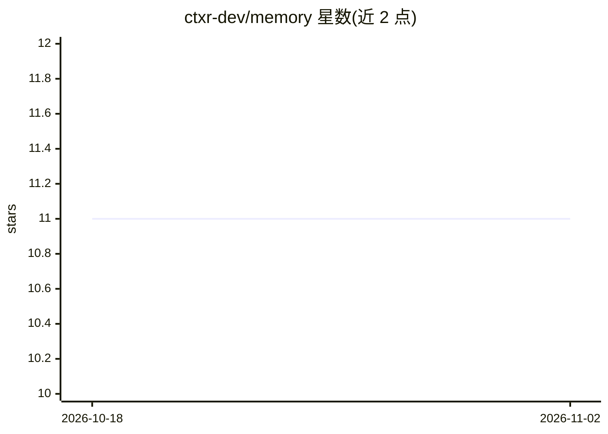

# ctxr-dev/memory

⭐ 11 · JavaScript · MIT · 推送 2026-09-27 · [GitHub](https://github.com/ctxr-dev/memory) · 组织维护

**AI 编码代理的本地项目记忆栈：Dify 知识库 + MCP 桥接**

供 AI 编码代理使用的本地记忆样板工程：以 Docker Compose 运行本地 Dify 知识库栈，经 stdio MCP 桥接为 Claude Code、Cursor、Codex 等 MCP 客户端提供记忆工具。核心机制是两阶段管线——Flush 阶段由生命周期钩子调用本地 LLM（默认 Claude Code CLI，支持 Codex/Anthropic/OpenAI）抽取类型化原子并追加到当日文档；Compile 阶段对新一天做去重合并沉淀。另设 self_improvement 数据集记录用户纠正，代理经 recall_lessons 事前查阅。安装分宿主安装与 Dify 引导两阶段，需 Docker、Node 20+ 与 bash。

## 筛选速览

| 维度 | 判定 | 备注 |
|---|---|---|
| AI 角色 | `ai-ecosystem` | LLM/agent 周边工具 |
| 许可风险 | `permissive` | MIT |
| 部署形态 | `self-host` | docker 或自建部署 |
| 模型依赖 | — | README 未给出锁定关系 |
| 硬件要求 | — | 无带数字的原话,不猜 |
| 安装摩擦 | `low` | 无编译、无系统依赖或容器化 |
| 成熟度 | — | 结构信号不足 |

## 能力要点

- Flush + Compile 两阶段管线，将会话蒸馏为类型化原子而非转储原文
- stdio MCP 桥接 Claude Code / Cursor / Codex 等 MCP 客户端
- self_improvement 数据集捕获纠正反馈，代理经 recall_lessons 事前查阅
- ExitPlanMode 钩子自动捕获已批准的计划到 Dify plans 数据集

## 适用场景

- 让编码代理跨会话记住项目决策、bug 根因与教训
- 沉淀每日会话为可检索的本地知识库
- 在开始相关工作前查阅过往纠正反馈以避免重复错误

## 场景标签

`Agent 记忆` · 领域:Agent 开发

## 证据(README 行号)

> L7:  A local Dify Knowledge stack for high-precision RAG, a stdio MCP bridge for every modern agent client, a two-stage 
> L49: 1. **Flush.** Lifecycle hooks (`PreCompact`, `PostCompact`, `SessionEnd`) call your local LLM (Claude Code CLI by d

## 星数曲线

2026-10-18 11 → 2026-11-02 11（+0）

---
*卡片 v1 · prompt 1.4 · 生成 2026-11-02 · 置信度 high · 依据 README sha `c2b6c8061dcd` · [字段定义](../../DATASET.md)*
