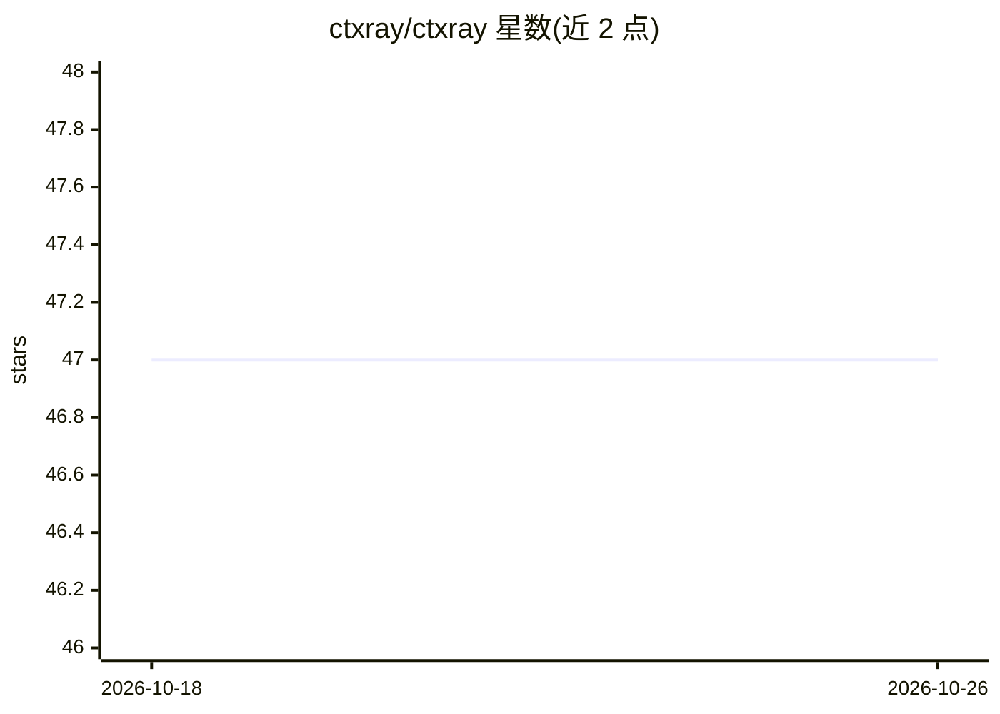

# ctxray/ctxray

⭐ 47 · Python · MIT · 推送 2026-06-24 · [GitHub](https://github.com/ctxray/ctxray) · [官网](https://getreprompt.dev) · 个人维护

**本地分析 AI 编程会话与提示词质量的 CLI 工具**

Python CLI，自动发现并读取 Claude Code、Cursor、ChatGPT 等 9 种 AI 编程工具的历史会话与提示词，本地生成个人使用模式报告、会话质量评分、隐私暴露扫描（API key/PII）与跨工具对比。提供基于 10 篇论文校准的提示词 0-100 评分（30+ 特征）、规则式改写与压缩，全部纯规则无 LLM 调用，无需网络。可通过 GitHub Action、pre-commit 接入 CI 作为提示词质量门禁，另有浏览器扩展与 MCP server 可选安装。需 Python 3.10+。

## 筛选速览

| 维度 | 判定 | 备注 |
|---|---|---|
| AI 角色 | `ai-ecosystem` | LLM/agent 周边工具 |
| 许可风险 | `permissive` | MIT |
| 部署形态 | `library` | 以包/库形式分发 |
| 模型依赖 | — | README 未给出锁定关系 |
| 硬件要求 | — | 无带数字的原话,不猜 |
| 安装摩擦 | `low` | 无编译、无系统依赖或容器化 |
| 成熟度 | — | 结构信号不足 |

## 能力要点

- 支持 9 种 AI 编程工具的提示词自动发现与解析（适配器模式）
- 纯规则评分/改写，无 LLM 调用，本地运行 <1ms/提示
- 隐私扫描检测已发送提示词中的 API key、token、密码与 PII
- GitHub Action / pre-commit 集成的提示词 lint 质量门禁

## 适用场景

- 回顾我在各 AI 编程工具中的使用模式与提示词弱点
- 在 CI 中对提示词做质量门禁
- 检查我是否已把密钥或 PII 发给 AI 工具
- 压缩与改写提示词以减少 token 消耗

## 场景标签

`提示工程` `网络安全` · 领域:Agent 开发

## 证据(README 行号)

> L5: X-ray your AI coding sessions across Claude Code, Cursor, ChatGPT, and 6 more tools. Discover your patterns, find wa
> L28: Drop ctxray into your CI as a prompt quality gate. No LLM, no API key, no network — <50ms per prompt.
> L116: |`ctxray check "prompt"`|**Full diagnostic** — score + lint + rewrite + threshold pass/fail|

## 星数曲线

2026-10-18 47 → 2026-10-26 47（+0）

---
*卡片 v1 · prompt 1.4 · 生成 2026-10-25 · 置信度 high · 依据 README sha `62066e6458ec` · [字段定义](../../DATASET.md)*
