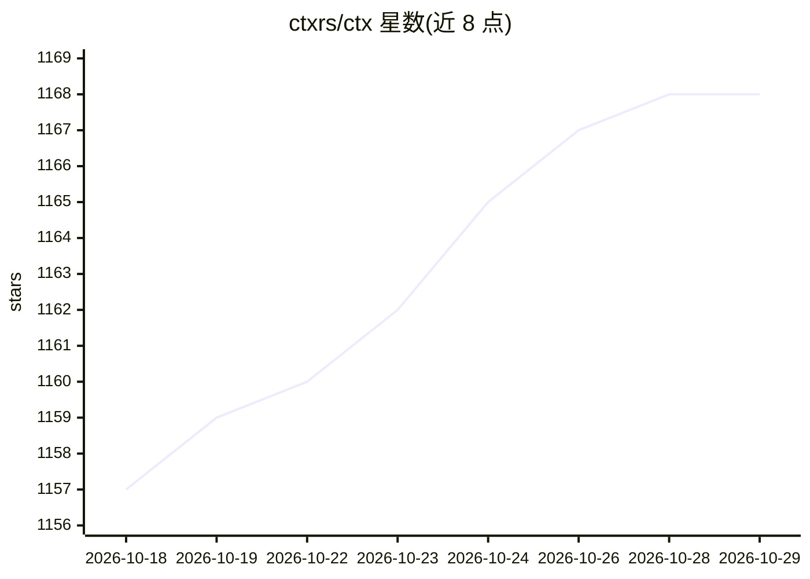

# ctxrs/ctx

⭐ 1,168 · Rust · Apache-2.0 · 推送 2026-10-27 · [GitHub](https://github.com/ctxrs/ctx) · [官网](https://ctx.rs) · 组织维护

**面向编码 agent 的本地历史检索、代码归因与降噪 CLI 工具链**

Rust 编写的本地 CLI 工具链：ctx setup 发现并索引 ~/.claude、~/.codex 等目录中的 agent 会话记录（JSONL/SQLite），转换为统一本地记录；ctx search 用 BM25 检索，语义检索本地计算嵌入、无需 API key；ctx blame 将代码行归因到产生该提交的 agent 会话并给出原转录引用；ctx graph 在 SQLite 中构建代码关系图；ctx sift 在 agent 读取前压缩工具输出。支持备份与团队共享（beta）。macOS/Linux/Windows 提供安装脚本。

## 筛选速览

| 维度 | 判定 | 备注 |
|---|---|---|
| AI 角色 | `ai-ecosystem` | LLM/agent 周边工具 |
| 许可风险 | `permissive` | Apache-2.0 |
| 部署形态 | `None` |  |
| 模型依赖 | — | README 未给出锁定关系 |
| 硬件要求 | — | 无带数字的原话,不猜 |
| 安装摩擦 | `low` | 无编译、无系统依赖或容器化 |
| 成熟度 | `idea` | |

## 能力要点

- 索引本地编码 agent 会话历史并支持 BM25/语义检索
- ctx blame 将代码行归因到 agent 会话并引用原始转录
- ctx graph 在 SQLite 中索引代码库依赖关系图
- ctx sift 压缩工具输出以减少 token 消耗，可恢复原始输出

## 适用场景

- 让新 agent 会话检索此前会话的决策、约束与失败尝试
- 追溯某行代码由哪个 agent 会话产生并查看原始上下文
- 大型代码库中快速查询符号间的调用与依赖关系

## 场景标签

`语义搜索` `Agent 记忆` · 领域:Agent 开发

## 证据(README 行号)

> L3: You already have months of coding agent history on your machine. **ctx** lets you search it and blame code to the se
> L47: ctx does not require hooks or any code running inside the agent process. Automatic indexing is on by default and ke
> L177: Use `ctx integrations install skill` and `ctx integrations install mcp --agent codex`.

## 星数曲线

2026-10-18 1,157 → 2026-10-29 1,168（+11）

---
*卡片 v1 · prompt 1.4 · 生成 2026-10-21 · 置信度 high · 依据 README sha `b0dfd7ea9ec5` · [字段定义](../../DATASET.md)*
