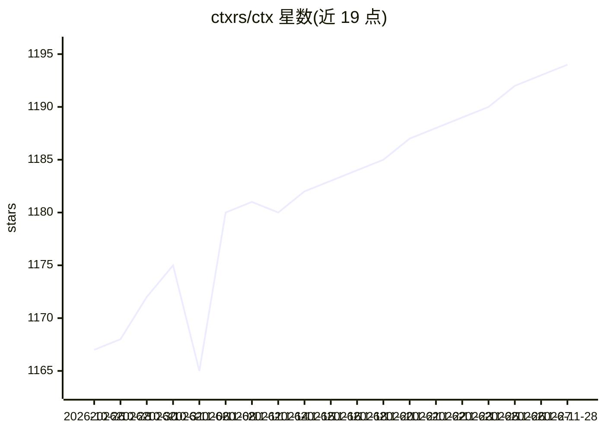

# ctxrs/ctx

⭐ 1,194 · Rust · Apache-2.0 · 推送 2026-11-21 · [GitHub](https://github.com/ctxrs/ctx) · [官网](https://ctx.rs) · 组织维护

**为 coding agent 提供本地会话历史检索与代码归因的 CLI 工具链**

本地运行的 Rust CLI 工具链，包含四个子工具：ctx setup 检索 ~/.claude、~/.codex 等目录中的 agent 会话记录并建立本地索引；ctx search 支持 BM25 词法匹配与本地计算的语义搜索（内置模型无需 API key）；ctx blame 将代码行归因到产生该提交的 agent 会话并给出 transcript 引用；ctx graph 以 Rust 重写 Graphify，用 SQLite 索引代码图谱；ctx sift 在工具输出进入 agent 前压缩冗余内容。数据默认留在本机，分享需自行 opt-in。

## 筛选速览

| 维度 | 判定 | 备注 |
|---|---|---|
| AI 角色 | `ai-ecosystem` | LLM/agent 周边工具 |
| 许可风险 | `permissive` | Apache-2.0 |
| 部署形态 | `None` |  |
| 模型依赖 | — | README 未给出锁定关系 |
| 硬件要求 | — | 无带数字的原话,不猜 |
| 安装摩擦 | `low` | 无编译、无系统依赖或容器化 |
| 成熟度 | — | 结构信号不足 |

## 能力要点

- 索引并检索本机已有的 agent 会话 transcript（JSONL/SQLite 来源）
- ctx blame 将代码行归因到 agent 会话并附 transcript 引用
- 语义搜索在本地计算嵌入，内置模型无需 API key
- ctx graph 以 Rust 实现代码图谱，索引存于 SQLite

## 适用场景

- 让新会话检索历史会话中的决策与已试过的失败方案
- 追溯某段代码由哪个 agent 会话产生并查看原始记录
- 为大型仓库建立调用关系图谱供 agent 查询
- 压缩工具命令输出以降低 agent 的 token 消耗

## 场景标签

`语义搜索` · 领域:知识与检索

## 证据(README 行号)

> L3: You already have months of coding agent history on your machine. **ctx** lets you search it and blame code to the se
> L45: `ctx setup` discovers those sources and reads them without modifying them. It converts each provider’s format into 
> L179: Optional project graph tool hooks use `ctx graph install --platform gemini --project PATH` (or `claude` or `codebu

## 星数曲线

2026-10-26 1,167 → 2026-11-28 1,194（+27）

---
*卡片 v1 · prompt 1.4 · 生成 2026-11-23 · 置信度 high · 依据 README sha `15cfc93de949` · [字段定义](../../DATASET.md)*
