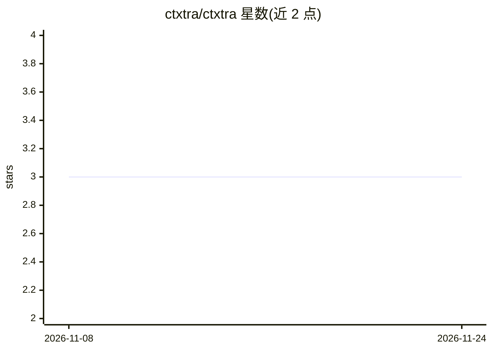

# ctxtra/ctxtra

⭐ 3 · Go · MIT · 推送 2026-11-20 · [GitHub](https://github.com/ctxtra/ctxtra) · 个人维护

**为 AI agent 会话绑定个人与团队指令文件的上下文管理 CLI**

一个 Go 编写的 CLI 工具，通过文件夹或 Git remote 的绑定规则，在 agent 会话启动时预载用户指定的指令文件并挂载技能，不向仓库写入任何内容。支持团队以 git 仓库形式分发 Markdown 指令包，包固定到 commit、更新需用户确认，绑定只能指向包自身文件。提供 context show/explain 命令查看与解释匹配结果。处于 preview 阶段，配置格式可能变动，仅支持 macOS 和 Linux，MIT 许可。

## 筛选速览

| 维度 | 判定 | 备注 |
|---|---|---|
| AI 角色 | `ai-ecosystem` | LLM/agent 周边工具 |
| 许可风险 | `permissive` | MIT |
| 部署形态 | `library` | 以包/库形式分发 |
| 模型依赖 | — | README 未给出锁定关系 |
| 硬件要求 | — | 无带数字的原话,不猜 |
| 安装摩擦 | `low` | 无编译、无系统依赖或容器化 |
| 成熟度 | `idea` | |

## 能力要点

- 按文件夹/Git remote/worktree 绑定指令文件到 agent 会话
- 团队指令包固定 commit 分发，更新需用户确认
- context show/explain 输出会话获得的确切文本及匹配原因
- 自带可安装的 skill，让 agent 代为操作 ctxtra

## 适用场景

- 在多个仓库间复用个人 AI agent 指令而不污染仓库
- 团队统一分发各项目的 agent 编码规范
- 按仓库控制技能只在需要的项目中生效

## 场景标签

`提示工程` · 领域:Agent 开发

## 证据(README 行号)

> L1: ctxtra: your own layer of agent context. Personal and team instruction files and skills, bound to agent sessions
> L26:  ctxtra hooks into every agent. Bindings add your own instruction files and a pinned team package to sessions by fo
> L88: Claude Code · Codex CLI · GitHub Copilot CLI · Cursor (CLI and app) · OpenCode · Pi · Antigravity · Devin ·

## 星数曲线

2026-11-08 3 → 2026-11-24 3（+0）

---
*卡片 v1 · prompt 1.4 · 生成 2026-11-22 · 置信度 high · 依据 README sha `df897d7a9de9` · [字段定义](../../DATASET.md)*
